# Event flows：TSF、engine 與 core 的實際事件路徑

狀態：以 `main` `3ca8911` 的程式為準，分支 `event-flows` 只新增文件。這份文件不從舊設計稿推論，每個 sequence diagram 的函式名都能在 repo 找到；不確定的地方標 `（待確認）`。

## 先看結論

一次按鍵會經過三個決策層，責任邊界如下：

1. **TSF 決定「這一鍵要不要先攔」**。`OnTestKeyDown` 只做預測，`OnKeyDown` 才送 IPC。實際方法在 `crates/jc-tsf/src/service.rs` 的 `wants_key`、`english_key_policy`、`handle_key`。
2. **engine 決定「這個請求要落到哪個 session / 哪個 op」**。快捷鍵在 engine 先查 `settings_keymap`，一般按鍵才交給 `Session::press`。位置在 `crates/jc-engine/src/lib.rs` 的 `handle`。
3. **core 決定「按鍵語意、候選、游標、刪除、學習」**。入口是 `Session::press`，候選套用是 `CandidateAction`，顯示與提交共用 `display_text`／`commit_text`。

TSF 目前沒有把中英模式送給 engine。`english` 是外殼狀態，core 只看到按鍵與片段；`Request::Mode` 已從協定刪除，TSF 也不再送它。

## 1. 元件圖

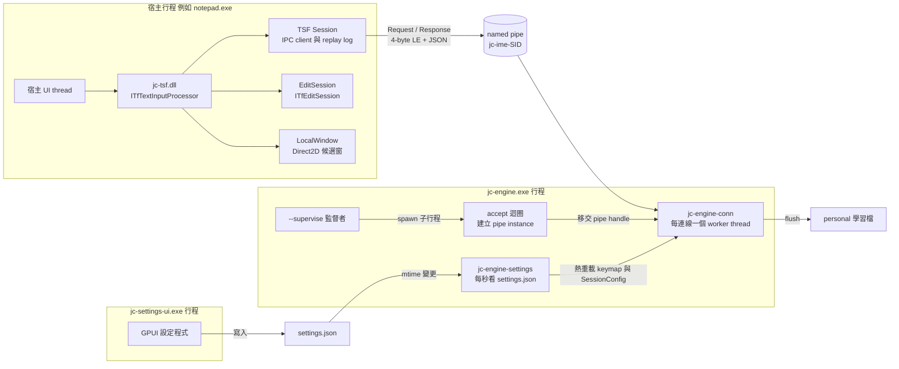

補充：

- `jc-tsf.dll` 載入宿主行程，`TextService` 是 COM 物件，掛在宿主收到按鍵的 UI thread。候選窗 `LocalWindow` 也在同一個行程自繪，沒有獨立候選窗程序或 pipe。
- `jc-engine.exe --supervise` 是常駐監督者，子行程才是 `--socket` 服務者。每條 pipe 連線一個 worker thread，session 屬於連線，不跨 thread 共用。
- `jc-settings` 是純資料 crate，設定程式與 engine 共用。`jc-settings-ui` 只寫 `settings.json`，engine 的 watcher 熱重載。
- `EditSession` 是 TSF 的 `ITfEditSession` 回呼，跑在宿主提供的 edit cookie 裡。`edit::apply` 用它更新組字區、提交文字與游標。

## 2. wire 訊息一覽

訊框格式：4-byte 小端長度 + JSON，上限 `jc_proto::frame::DEFAULT_MAX_FRAME`。`Request`／`Response` 的 serde tag 是 `op`，snake_case。以下以 `crates/jc-proto/src/lib.rs` 的 variant 為準。

### 2.1 `Request`

| variant | 誰送 | 誰收 | 什麼時候 |
|---|---|---|---|
| `Hello { protocol, client }` | TSF `Session::ensure_open`，其他 client | engine `handle` | 開 session、重連後第一次請求。版本不符會回 `VersionMismatch` 並關線 |
| `Key { key }` | TSF `handle_key`、`handle_chord`；英文 Enter 與 IMM32 word-end 也走這條 | engine `handle` | 一般按鍵、快捷鍵 chord、英文 Enter、IMM32 word-end |
| `Literal { text, session }` | TSF `handle_literal` | engine `handle` | Shift＋字面、外殼已決定不進注音／かな狀態機的文字 |
| `Snapshot` | TSF `to_jc_request` 的 `display`、重連對齊 | engine `handle` | 取得目前完整狀態，不改組字 |
| `Commit` | TSF `finish`、`complete_via_cuas` | engine `handle` | 明確送出目前組字。Enter 的一般路徑由 engine 直接呼叫 `Session::commit` |
| `Select { index }` | TSF 候選窗滑鼠點選 `select_in_edit` | engine `handle` | 直接套用第 `index` 個候選，和數字鍵共用 `choose_candidate` |
| `Idle { session }` | TSF 停頓計時器 `ja_live_idle` | engine `handle` | 日文逐字変換的停頓觸發；沒有日文組字時是 no-op |
| `Health` | TSF `refresh_bindings`、`learn_mode`、`simplified_hotkey` | engine `handle` | 查 bindings、能力旗標、簡體開關、慢請求診斷 |
| `Close { session }` | TSF `Session::reset`、`Drop` | engine `close_session` | 關閉這條連線的 session，會 flush 個人學習 |
| `OutputSimplified { on }` | TSF `set_output_simplified`、`output_simplified` | engine `handle` | 狀態列切換簡體輸出。只改提交，不改組字預覽 |
| `Ping` | 測試、smoke 或外部 client | engine `handle` | 存活檢查，回 `Acknowledged` |
| `ApplySettings { settings }` | 目前沒有 TSF 生產者；外部工具可送 | engine `handle` | 要求 engine 立刻從設定檔重讀，回 `Health` |
| `Drain` | 升級交接的外部 client | engine `handle` | 等組字結束、flush、斷線，讓外殼重連新版 |
| `Vocab { directive, vocab }` | 目前沒有 TSF 生產者；詞彙工具可送 | engine `handle` | 自訂詞彙指令。目前 engine 未實作，落到 `Unsupported` |
| `ResetPersonal` | 目前沒有 TSF 生產者；外部工具可送 | engine `handle` | 清空個人學習並存檔，回 `Acknowledged` |
| `Shutdown` | 測試、smoke 或外部 client | engine `handle` | 整個引擎行程結束，回目前 snapshot |
| `Unknown` | serde `other` | engine `handle` | 不認得的 op，回 `UnknownOp` |

### 2.2 `Response`

| variant | 誰送 | 誰收 | 什麼時候 |
|---|---|---|---|
| `Ready { protocol, engine, session, bindings }` | engine | TSF `ensure_open` | `Hello` 成功。`bindings` 是 action 到正規化 chord 的表 |
| `State { preedit, cursor, candidates, details, segments, highlighted, cursor_rune, suggestion, label, navigating, rows, columns, handled, menu }` | engine | TSF `parse` | 每一次按鍵、snapshot、idle、select 的完整狀態 |
| `Committed { text }` | engine | TSF `parse` | Enter 或 `Commit` 真的送出文字。`text` 已套用簡體與標點 |
| `Error { code, message }` | engine | TSF `parse`／`to_jc_request` 的錯誤路徑 | 版本不符、未知 op、frame 錯誤、內部錯誤 |
| `Acknowledged { session }` | engine | TSF、外部 client | `Ping`、`Close`、`ResetPersonal` 的成功回報 |
| `Health { info }` | engine | TSF `learn_*` | 能力、bindings、設定版次、慢請求、session 數 |
| `Vocab { vocab }` | 目前沒有生產者 | 詞彙工具 | variant 已定義，但 `Request::Vocab` 在 engine 仍落到 `Unsupported` |

`handled` 是 TSF 要不要吃鍵的權威值。`Some(false)` 用在候選 index 越界與混合英文沒有補全時的 Tab；引擎對組字中的 Backspace／Delete 即使把 preedit 刪空也會明確回 `Some(true)`。

`jc-proto::Response::State` 只有 `suggestion: Option<String>`，沒有補全來源。英文補全在 core 已進候選清單：混合模式打 `hellp` 按 Tab 會開候選窗 `[0] hellp`、`[1] hello`，由一般 `CandidateAction` 套用。英文模式（外殼 `english=true`）的文字輸入零 IPC：printable、Tab、方向鍵、Enter、Backspace 都交還宿主，也不產生組字、補全或候選窗；已註冊的全域 chord 是唯一例外，仍送一個 `Request::Key` 讓 engine 執行 keymap command。

## 3. 逐事件 sequence diagram

participant 對照：`Host` 宿主程式，`TSF` jc-tsf 的 `TextService`，`TSession` TSF 的 `Session`，`Pipe` named pipe，`Engine` jc-engine，`Core` jc-core 的 `Session`，`Edit` TSF EditSession，`UI` 候選窗。

### 3.1 啟動、hello、Ready、bindings 與重連

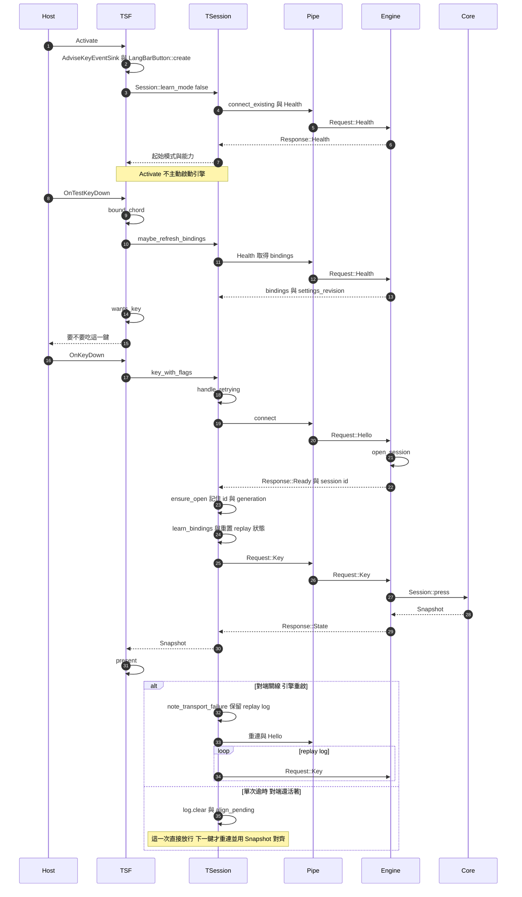

重點：

- `ensure_open` 只在 `id == 0` 或 generation 改變時重開。重開失敗會把 `id` 歸零，下一鍵再試。
- `Ready.bindings` 與 `Health.bindings` 都會進 `learn_bindings`。`bound_chord` 每 5 秒最多刷新一次，避免每個按鍵都問 engine。
- 重播只重送組字中的請求。TSF 在收到 commit、cancel 或組字結束時清掉 log。

### 3.2 一般可列印鍵

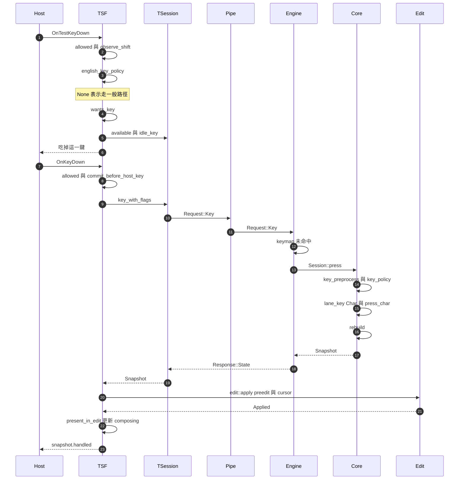

`OnTestKeyDown` 的答案會被 `key_tested` 記住，讓緊接的 `OnKeyDown` 不再問一次；這個紀錄只給同一個 vk 用一次。若 `OnKeyDown` 最後得到 `handled=false`，TSF 回 `false`，宿主收到原始按鍵。

中文 idle 時不是所有 printable 都會進來。`wants_key` 只在 `idle_key` 認定這一鍵是注音起始、聲調鍵或全形字元時回 `true`；其他可列印字元直接放行給宿主。英文模式一律放行，不經引擎。

### 3.3 注音輸入

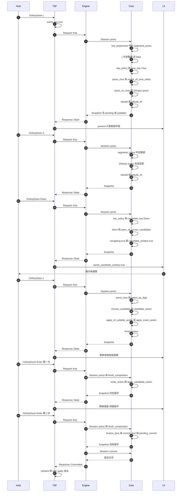

注音決策順序：

1. `segments_press` 先處理聲調、聲調選填、孤立字面空白。回傳 `true` 代表這一鍵已被吃掉。
2. `key_policy` 依 `candidate_key`、`lane_key`、`global_key` 的固定順序決策。
3. 數字鍵只有 `candidate_window` 開著才走選字；`select_by_digit` 先找高亮所在頁與欄，再換算絕對 index。
4. Enter 第一次只套用高亮候選，第二次才 `finalize_lane`。選單是例外，套用即送出。

注音補全仍會出現在 `suggestion`；英文補全則同時進了候選清單。TSF 不再區分 suggestion 來源，也不再有 `english_pending`。

### 3.4 英文模式

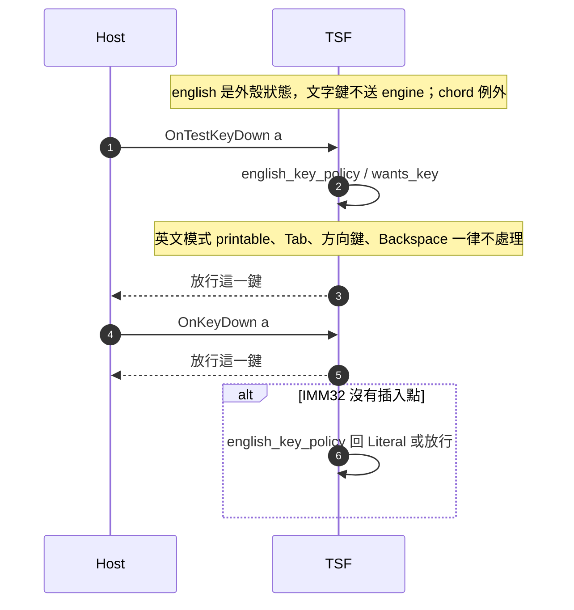

英文模式文字輸入是純 raw：外殼 `english=true` 時 printable、Tab、方向鍵、
Enter、Backspace 都不產生 `Request`，也不建組字、不顯示候選窗；Shift＋空白
同樣直接交給應用程式，不由外殼插入全形空白。`english_key_policy` 只保留
IMM32 raw passthrough；Caps Lock 與其他按鍵交給系統與應用程式。已註冊的
全域 chord（例如 Ctrl+Alt+,）例外，仍會送一個 `Request::Key`，由 engine 的
keymap 執行 command。混合模式的英文補全改走 Tab 開候選窗，不屬於英文模式。

### 3.5 Caps Lock

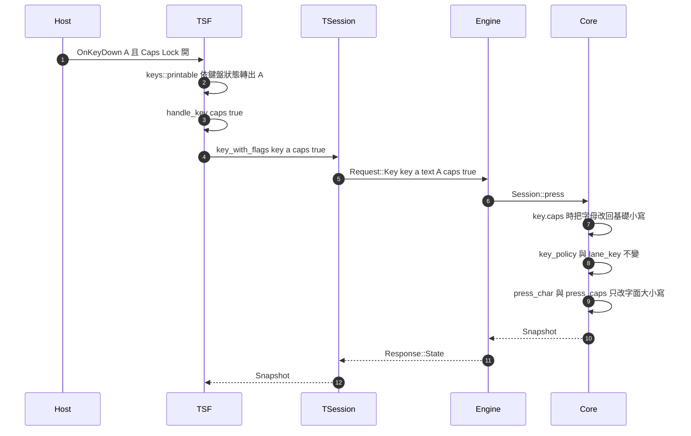

Caps Lock 不改變按鍵路由，也不切換中英模式。注音模式仍把字母當注音鍵，`Key.caps` 只影響最後的字面大小寫；英文與混打的 Latin 字面由 `press_caps` 決定輸出。Caps Lock 狀態本身不會為了同步模式而送出 health 或任何 `Request`。

### 3.6 日文

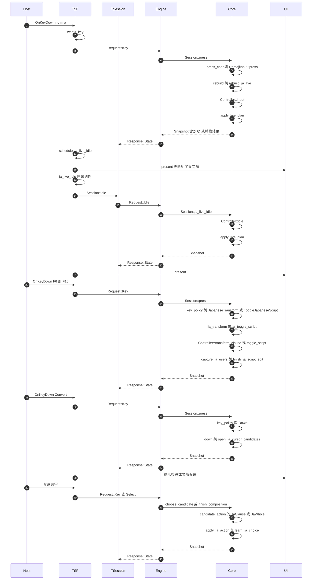

日文的 ownership 在 core 的 `Composition`：

- `rebuild_ja_live` 先用 `common_prefix_units` 保留共同讀音，再 `retain_units_through` 決定哪些 User 片段不能重轉。
- `Controller::input` 只回傳 `LivePlan`，真正換字在 `apply_live_plan`。
- 刪除後的畫面用 `mark_user_units` 固定成 User 片段，避免 `わし` 被重新轉成 `はし`。
- 文節切分、鎖定與 `clause_spans` 都由 `Controller` 提供；TSF 只收到 `segments[].mode == japanese` 與候選字串，不自己判斷文節。

### 3.7 刪除

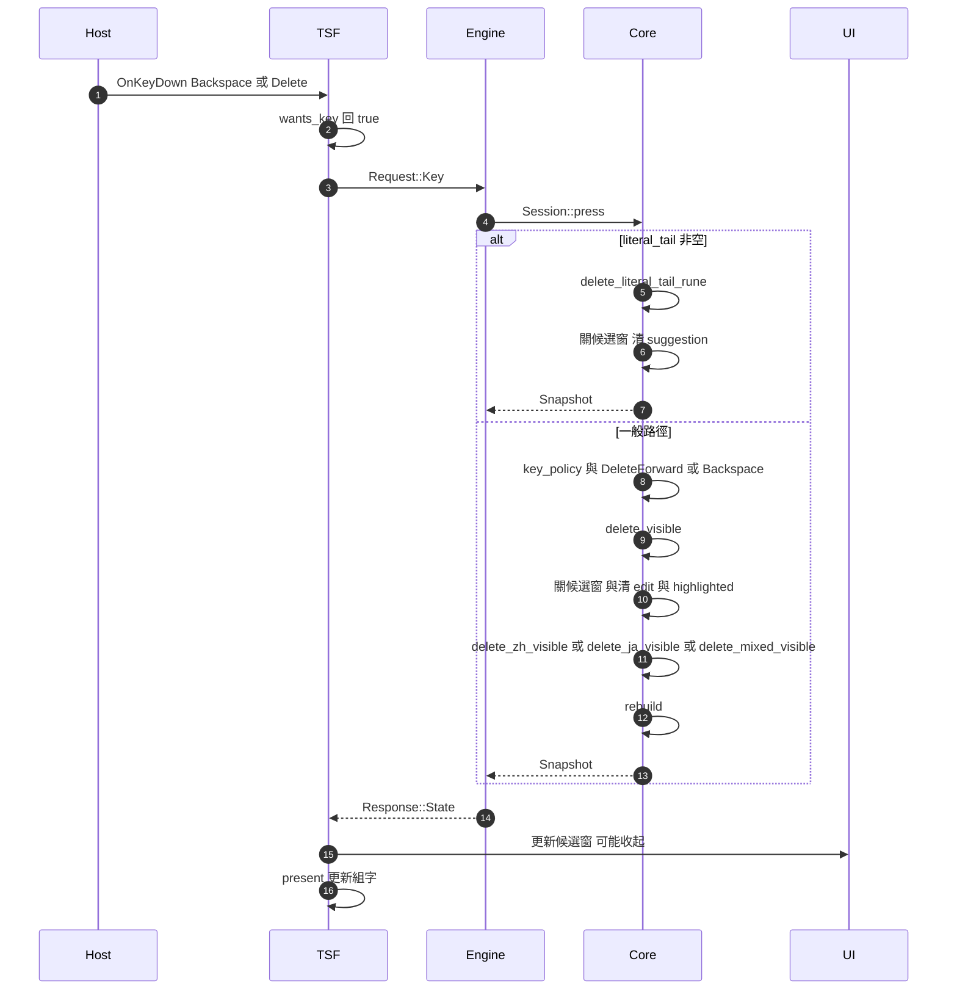

刪除單位是一個可見 rune，不是一個按鍵或一個音節。若一個可見字元底下涵蓋多個讀音單位，`zh_units_at_rune` 或 `ja_units_at_rune` 會回傳整個範圍，`remove_syllable_range` 或 `delete_units` 一次移除該字元涵蓋的單位；正常一對一時就是刪一個字。

刪除後剩下的字面會留在原本的 lane：混打用 `AsciiInput::replay` 重建剩下的按鍵，日文用 `ja_delete_surface` 與 `mark_user_units` 凍結刪除後的畫面，注音用剩下的按鍵重播未完成音節。這樣後面的字元不會被重新判成注音或かな。

`Shift+Delete`／`Shift+Backspace` 在候選窗開著時先走 `CandidateAction::ForgetCandidate`，不會直接刪字。

### 3.8 候選操作

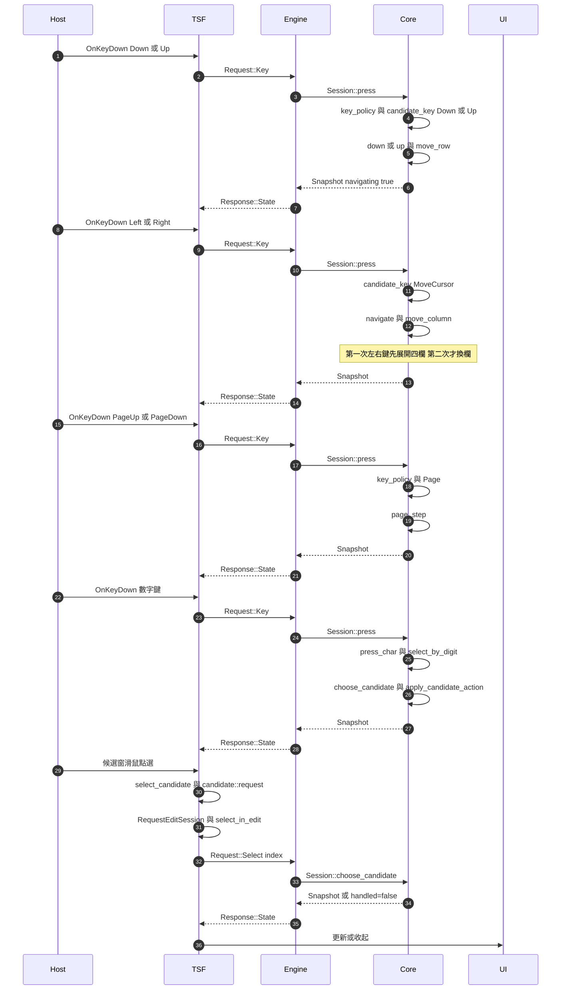

游標單位：

- `move_row` 用 `CandidateLayout::up`／`down`，上下鍵是線性移動，跨欄、跨頁自然接續。
- `move_column` 用 `CandidateLayout::left`／`right`，左右鍵跳一整欄，同一個列號；單欄時不移動。
- `page_step` 用 `page_size` 換頁，頁碼頭尾相接。
- 注音的左右鍵在候選窗開著但尚未 `navigating` 時是移動組字游標；進入選取後才換候選。

### 3.9 選單

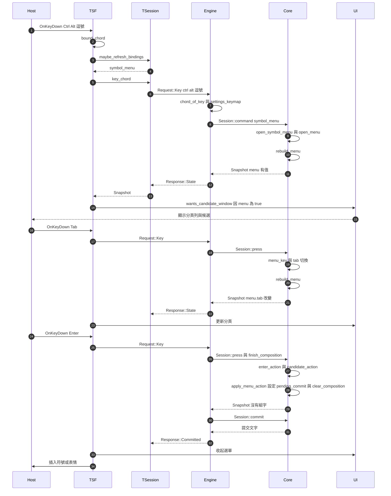

選單的 chord 由 engine 的 `settings_keymap` 決定，TSF 只用 `bindings` 決定要不要攔這一鍵。`settings_keymap` 由 `config_watch::reload` 從 `settings.json` 重建，`settings_revision` 改變時 TSF 下一次 `bound_chord` 會刷新本地表。

### 3.10 提交

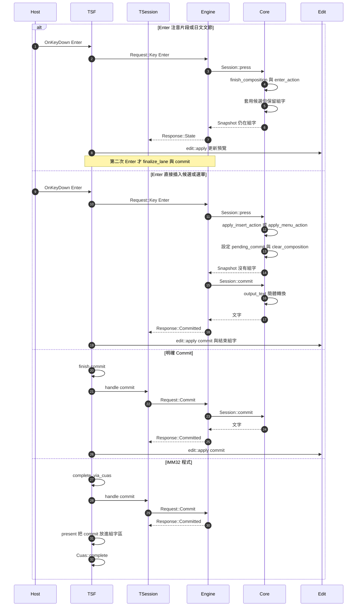

`preedit` 與 `commit` 的差異：

- `Snapshot.preedit` 是 `composed_text`：畫面文字，包含尚未完成的注音、日文かな與字面尾巴。
- `commit_text` 與 `display_text` 是同一份來源。`display_text` 先看待提交的 `pending_commit`，沒有才回 `composed_text`。
- `Session::commit` 才套用 `output_text` 的簡體轉換；`finalize` 的標點與中英空格在 Enter 的 `finalize_lane` 先做一次。組字中的預覽保持繁體。
- `edit::apply` 的 `RequestEditSession` 先要求同步 `TF_ES_SYNC`。同步被拒時，若有提交文字會改排非同步 `TF_ES_ASYNCDONTCARE`；已寫入的提交不會重跑，避免重複插入。

### 3.11 學習

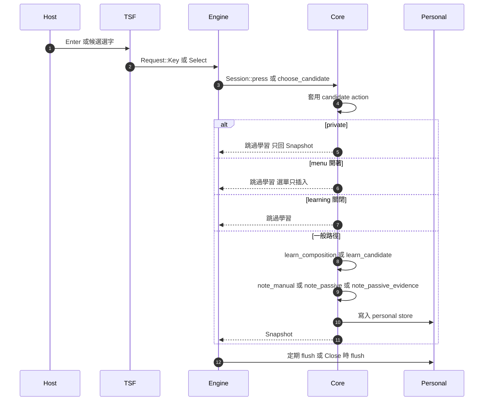

實際條件：

- `private` 為真時 `learn_composition` 與 `learn_candidate` 都直接返回。TSF `handle_retrying` 會把 `private` 放進每個請求。
- `menu.is_some()` 時不學習。選單候選由 `apply_menu_action` 插入，`CandidateAction.learn` 預設 `false`。
- `config.learning == false` 時不學習。注音短讀音還有 `min_trigger_len` 的 passive 證據路徑。
- 手選與被動接受的證據量不同：`candidate_window` 開著時 `manual` 為真，走 `note_manual`；否則被動走 `note_passive` 或 `note_passive_evidence`。
- 下一次按鍵若是 Backspace、Esc 或 Ctrl+Z，`resolve_pending_learning` 會在 rollback 窗口內補償上一次學習。

重播沒有獨立的「不要學習」旗標。`Engine::replay_into` 直接對新 session 重跑 log 裡的 `Request::Key`、`Request::Literal`、`Request::Commit` 等；會不會寫入取決於 log 內容。TSF 的 log 會在 commit、cancel 或組字結束時清空，一般不會把已提交的 Enter 留在重播裡；若 log 真的包含會套用候選的 Enter，重播仍會再走一次學習。（待確認：是否要在 replay 路徑明確關閉學習。）

### 3.12 模式切換

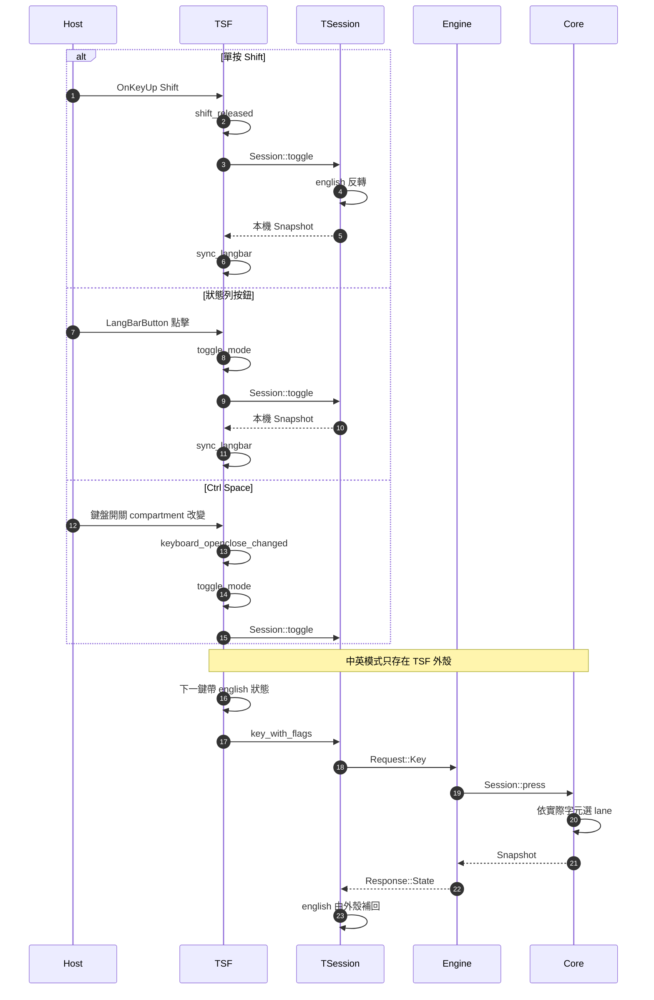

- `Session::toggle` 不送 IPC，也不提交組字。英文待選字在切回中文時丟掉，中文組字保留。
- `Request::Mode` 已從協定與 engine 刪除；TSF 不送。Caps Lock 只影響字面大小寫，不切換中英模式，也不送模式請求。
- 日文不是外殼模式。core 依片段推斷日文，F6–F10／Convert 只看 capability，不看 `english`。

## 4. 決策歸屬表

| decision | TSF | engine | core | 目前程式位置 |
|---|---|---|---|---|
| 這一鍵要不要吃 | `OnTestKeyDown` 先問 `wants_key`，`key_tested` 只給緊接的 `OnKeyDown` 用 | `handled` 由 core 快照決定，候選越界明確回 `false` | `press` 的 `KeyOutcome` 與 lane 狀態 | `service.rs:1731` `wants_key`、`service.rs:2291` `OnTestKeyDown`、`service.rs:2433` `OnKeyDown`、`engine/lib.rs:604` `handle`、`session/mod.rs:801` `press` |
| 送什麼 op | `to_jc_request` 把 0c 形狀轉成 `Request` | `handle` 分派到 `Key`、`Literal`、`Commit`、`Select`、`Idle` 等 | 不決定 op | `session.rs:646` `to_jc_request`、`engine/lib.rs:604` `handle` |
| 候選範圍 | 只轉發 Down／Up／Page／左右鍵，不決定範圍 | 不決定範圍 | `down` 依 lane 開整段、片段或最後一格；`zh_window_last`、`edit`、`mixed_target` 決定範圍 | `core.rs:1490` `down`、`core.rs:1086` `open_ja_cursor_candidates`、`mixed.rs:2023` `open_zh_cursor_candidates` |
| 游標單位 | `present_in_edit` 只用 `cursor_utf16` 定位 | 不決定單位 | 注音是音節格，日文是 byte 再換算 rune，混打是 rune；權威值 `cursor_rune` | `core.rs:2055` `navigate`、`core.rs:1591` `move_cursor_to`、`core.rs:1656` `candidate_edge` |
| 字面大小寫 | `keys::printable` 依鍵盤狀態轉字元；`handle_key` 帶 `caps` 與 `shift` | 不決定大小寫 | `press` 把 Caps Lock 字母改回基礎小寫，路由不變；`press_caps` 只改 Latin 字面 | `service.rs:1163` `handle_key`、`session/mod.rs:801` `press`、`core.rs:344` `press_char` |
| 候選排序 | 不改順序 | 不改順序 | lane 的 nbest、個人學習、rerank 先排；`CandidateSet` 負責插 extras、去重、截斷、顯示字排第一 | `session/candidate_set.rs:96` `from_hypotheses`、`mixed.rs:1821` `zh_choice_candidates`、`core.rs:3043` `rebuild_ja` |
| 補全來源 | 不再推導來源；`parse` 只保存 `suggestion` 字串 | 只帶 `suggestion` 字串，沒有來源欄位 | `snapshot_suggestion` 決定 suggestion 內容；混合英文補全同時進候選清單 | `session.rs` `state_to_snapshot_value`／`parse`、`core.rs:1681` `snapshot_suggestion`、`session/key_policy.rs` `tab` |
| Enter 語意 | 只送 `Key` 或 `Commit`，不自行判斷 | `Key Enter` 先 `press`；還在組字回 `State`，否則 `commit` 回 `Committed` | `finish_composition` 先 `enter_action`；注音片段與日文文節保留組字，選單與直接插入候選清掉組字 | `engine/lib.rs:655` `enters` 分支、`core.rs:1750` `finish_composition`、`core.rs:902` `apply_menu_action`、`core.rs:1005` `apply_insert_action` |
| 模式 | `english` 只在外殼；`toggle` 不送 IPC。Caps Lock 只改字面大小寫，不切換模式 | 沒有 toggle 或 mode op | 只依字元與片段選 lane，沒有中英模式旗標 | `session.rs` `toggle` |
| 刪除單位 | 只送 Backspace／Delete | 只回 `handled` | `delete_visible` 一次刪一個可見 rune；字元涵蓋多個讀音單位時整個範圍一起刪 | `key_policy.rs:279` `delete_visible`、`key_policy.rs:331` `delete_zh_visible`、`key_policy.rs:427` `delete_ja_visible` |
| 候選窗何時顯示 | `wants_candidate_window` 與 `show` 條件 | 只帶 `navigating`、`menu`、`candidates` | `down`／`up` 設定 `navigating`；`open_menu` 設定 `menu` | `session.rs:423` `wants_candidate_window`、`service.rs:752` `show`、`core.rs:1891` `open_menu` |
| 候選編號 | 不產生 | `Response::state` 把 `selection_key` 放進 `CandidateDetail.key` | `selection_key` 只回傳頁內位置 `1` 到 `0` | `jc-proto/lib.rs:589`、`jc-core/src/candidate.rs:133` `selection_key` |
| 學習 | 只帶 `private` | `replay_into` 重跑 log 時暫停學習，不寫 personal、不改統計 | `learn_candidate`／`learn_ja_choice` 檢查 `private`、`learning`、`menu`、`suppress_learn` | `core.rs` `learn_candidate`、`core.rs` `learn_composition`、`engine/lib.rs` `replay_into` |
| 選單分頁 | 只轉發 Tab／Enter／方向鍵 | 查 `settings_keymap` 執行 `symbol_menu`／`emoji_palette` | `menu_key` 切分頁，`apply_menu_action` 插入 | `core.rs:1971` `menu_key`、`core.rs:902` `apply_menu_action`、`engine/config_watch.rs:116` |

## 5. 常見誤解

### 5.1 Caps Lock 會不會改變按鍵路徑

你可能以為：Caps Lock 開著時，字母會走英文或大字模式，注音鍵會失效。

實際是：`Session::press` 在 `key.caps` 為真時只把 ASCII 字母改回基礎小寫，`key_policy` 仍照原本 lane 走。大小寫在最後的字面輸出才套用，注音字母仍然是注音鍵。`crates/jc-core/src/session/mod.rs:803` 到 `813`。

### 5.2 刪除單位

你可能以為：Backspace 刪一個注音按鍵，或刪一個音節。

實際是：`delete_visible` 先關候選窗，再用 `cursor_runes` 找游標左邊或右邊的一個可見 rune。若這個字元底下涵蓋多個隱藏讀音單位，`zh_units_at_rune`／`ja_units_at_rune` 會回傳整個範圍，一次刪掉。`crates/jc-core/src/session/key_policy.rs:279`。

### 5.3 候選 `[1]` 原始輸入是誰加的

這裡有兩個不同的東西：

- 候選窗上的編號 `1`、`2`、`0` 是 `jc_proto::Response::state` 呼叫 `selection_key` 放進 `CandidateDetail.key`，TSF 只負責畫。位置 `crates/jc-proto/src/lib.rs:589`。
- 候選清單第 2 項的原始輸入是 core 加的。`zh_choice_candidates` 先放目前值，再放 `raw`，所以索引 `1` 是原始按鍵；選單與 TSF 都不會插入這一項。位置 `crates/jc-core/src/session/mixed.rs:1821`。

### 5.4 Enter 兩段式與選單一次送出

你可能以為：所有 Enter 都是先套候選、再送出。

實際是：

- 注音片段與日文文節候選開著時，第一次 Enter 的 `finish_composition` 只套用高亮候選並保留組字，engine 回 `State`；第二次 Enter 才 `finalize_lane`，engine 回 `Committed`。
- 選單候選的 `CandidateAction.commit_on_apply` 為真，`apply_menu_action` 直接設 `pending_commit` 並 `clear_composition`；同一次 Enter 的 engine 就會走到 `Session::commit`，只插入一次。
- `ActionLane::Insert` 的 `apply_insert_action` 也是一次送出。其他 lane 的套用動作若保留組字，就還是兩段式；engine 只依 `snapshot.composing()` 決定回 `State` 或 `Committed`。

位置 `crates/jc-core/src/session/core.rs:1750`、`crates/jc-core/src/session/core.rs:902`、`crates/jc-core/src/session/core.rs:1005`、`crates/jc-engine/src/lib.rs:655`。

### 5.5 日文 live 與文節 ownership

你可能以為：TSF 選了候選就直接改字，core 下次重建會重猜。

實際是：日文的文節切分、鎖定與 User 片段都在 core 的 `Composition` 與 `ja::live::Controller`。`rebuild_ja_live` 先保留共同讀音與 User 片段，再讓 `Controller::input` 回 `LivePlan`；`apply_live_plan` 才換畫面。TSF 只收到片段與候選，不持有文節所有權。位置 `crates/jc-core/src/session/core.rs:3198`、`crates/jc-core/src/ja/live.rs:778`。

### 5.6 候選窗何時顯示

你可能以為：只要 engine 有候選或 `navigating` 為真就會顯示。

實際是：`Snapshot::wants_candidate_window` 是 `menu.is_some() || composing() && navigating`。`present_in_edit` 的 `show` 還要至少一個內容來源：候選、suggestion、reading hint 或 notice。所以：

- 一般打字只更新組字區，不彈候選窗。
- 按 ↓／↑ 後 `navigating` 為真才顯示。
- 選單開著時 `menu` 讓它一律顯示，不受 `navigating` 影響。

位置 `crates/jc-tsf/src/session.rs:423`、`crates/jc-tsf/src/service.rs:752`。

## 6. 待確認

1. 英文模式已無組字，舊 `key_with_flags` 的 `Up`／`Down`／`PageUp`／`PageDown` 本機快照特例已刪除；候選窗只存在於混合模式。
