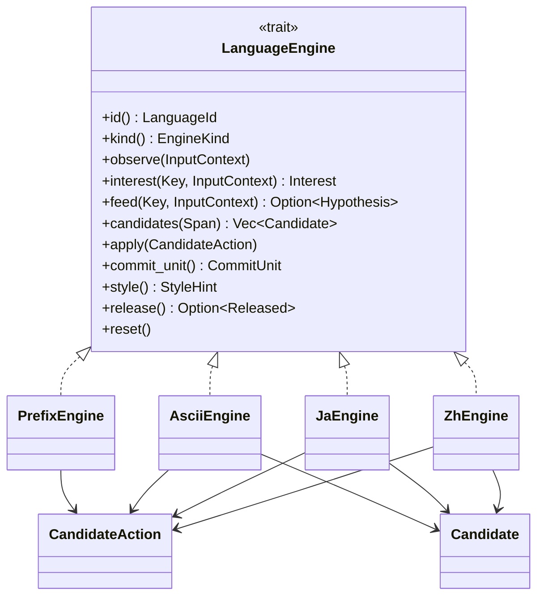
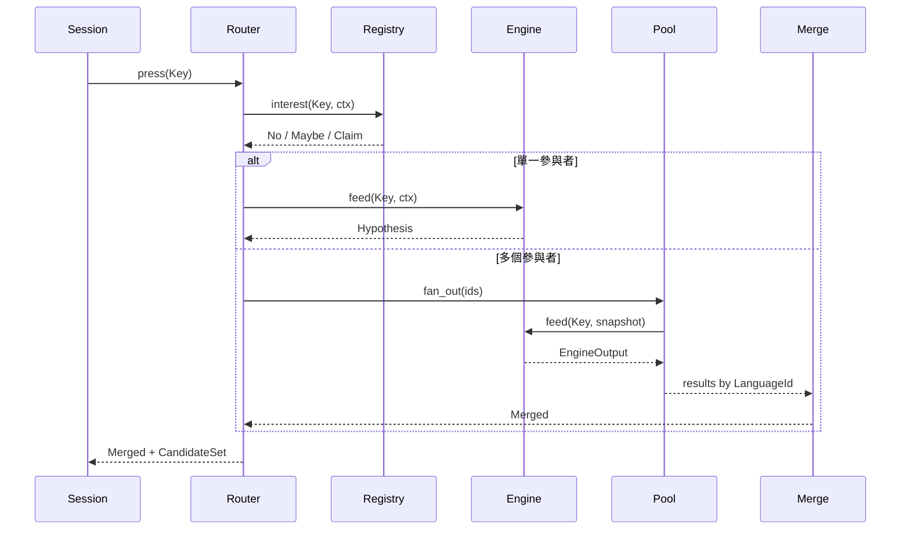
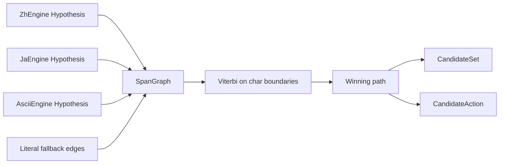

# language-engines：語言引擎介面與前導解析

狀態：設計文件；P1 語言引擎介面與 P1.5 前導解析已實作。
範圍：`crates/jc-core` 的按鍵分派、候選合併與前導解析；不改 `proto`、外殼與
產品行為。

## 0. 一句話

把「這一鍵由誰處理」、「誰產生哪一段假設」、「重疊的假設怎麼合併」從
`Session` 拆成一個可註冊的引擎介面；語言引擎只回資料，`Session` 仍是最後
唯一能改畫面、改組字與提交的地方。前導解析（反引號＋`u`／`b` 碼位查詢）
也走同一個介面，但它是控制引擎，不參與語言候選的合併。

## 1. 目標與非目標

### 目標

- 新增語言時只實作一個 `LanguageEngine` 並註冊，不改
  `Session::press()` 的按鍵流程、不改 `CandidateSet` 的組裝規則。
- 按鍵分派有明確的快速路徑：只有一個 `Claim` 時只跑那個引擎。
- 需要多個假設競爭時，引擎可以平行執行；合併結果與執行順序無關。
- 語言引擎只產生 `Hypothesis`／`Candidate` 資料，不直接插入文字、不提交、
  不改 `Snapshot`。
- 前導解析成為第一個非語言引擎（P1.5），讓 `u`／`b` 的狀態機與既有反引號
  標點前導共用同一個 ownership 模型。

### 非目標

- 這一輪不改產品行為、不改候選排序、不新增語言。
- 不承諾平行化後的延遲；所有效能數字都標「待量測」。
- 不把 `proto` 的候選格式改成引擎私有格式；`Candidate` 仍是線格式來源。
- 不把 `Composition` 的 `Auto`／`User` 所有權搬進引擎；所有權仍由
  `crate::composition::Composition` 決定。
- 不改 `KeyPolicy` 已固定的優先序：候選介面 → lane 專屬 → 全域。

## 2. 現況：以程式為準

### 2.1 輸入模式與 lane

`crate::lang::Mode` 目前只有 `Mode::Mixed`；`zh`、`ja`、`en` 都映射到
`Mode::Mixed`（`Mode::parse`）。lane 不是 enum，而是 `Session` 的狀態組合：

| 狀態 | 位置 | 意義 |
|---|---|---|
| `Session::zh_lane` | `crates/jc-core/src/session/mod.rs` | 這次組字走純注音狀態機。 |
| `Session::zh_space_closed` | 同上 | 注音 lane 按過空白，等下一個字元才交回混打。 |
| `Session::ja_run` | 同上 | 混打自動推斷出的日文片段。 |
| `Session::config.ja_only` | `SessionConfig` | 「Mixed 但只走羅馬字」的手動入口。 |
| `Session::in_zh_lane()` | 同上 | 回傳 `zh_lane`。 |
| `Session::in_ja_lane()` | 同上 | 回傳 `ja_run || config.ja_only`。 |
| 兩者皆 false | 同上 | 走 `AsciiInput` 與 `crate::mixed::Router` 的混打／英數路徑。 |

三條路徑共用同一個 `Session`，但狀態、刪除、空白、候選與套用各自有分支。
這就是「分派與合併仍綁在 `Session`」的實際位置。

### 2.2 一鍵的流程

`Session::press()`（`session/mod.rs`）依序做：

1. `expire_segment_view()`、Caps Lock 正規化、Shift 字面正規化。
2. 字面尾巴（`Session::literal_tail`）的 Backspace／Delete 特例。
3. 私密狀態與待定學習 `resolve_pending_learning()`。
4. 反引號前導：`Session::symbol_prefix` → `prefix_key()`；否則
   `KeyCode::Char('`')` → `start_symbol_prefix()`。
5. Ctrl：`press_ctrl()`。
6. 大寫字面 `capital_letter_literal()`。
7. `Session::style_key()`、`Session::menu_key()`。
8. `key_preprocess()`（實際是 `segments_press()`，處理注音聲調前置）。
9. `key_policy()`（`session/key_policy.rs`）：
   `candidate_key()` → `lane_key()` → `global_key()`。
10. 一般字元進 `press_char()`（`session/core.rs`）。

`press_char()` 再分：

- `in_ja_lane()`：`RomajiInput::press()`；`Rejected` 時
  `leave_ja_run_for_mixed()` 把原始羅馬字交回混打。
- `zh_lane`：`mixed_zh_lane_continues()` 成立就 `press_zh_char()`，否則
  `leave_zh_lane_for_mixed()` 重播整段按鍵。
- 尚未進 lane：`mixed_zh_lane_starts()` 成立就進注音 lane；否則
  `AsciiInput::tone()`／`press_caps()`，再 `try_japanese_run()`。

### 2.3 重建

`Session::rebuild()`（`session/core.rs`）只選一條路徑：

```rust
if self.in_ja_lane() {
    self.rebuild_ja();
} else if self.zh_lane {
    self.rebuild_zh();
} else {
    self.rebuild_mixed();
}
```

- `rebuild_zh()`：`Lattice::build()` → `zh_decoder()` →
  `Decoder::nbest()` → `rank_zh_hypotheses()` →
  `prefer_dictionary_hypothesis()`，再 `sync_composition_zh()`。
- `rebuild_ja()`／`rebuild_ja_live()`：`RomajiInput::units()`、
  `JaDecoder`、`LiveController`，再 `sync_composition_ja()`。
- `rebuild_mixed()`：`AsciiInput`；有增量切分時走
  `incremental_latin_split()`／`apply_latin_split()`，否則
  `rebuild_mixed_legacy()`；候選由 `rebuild_mixed_candidates()` 與
  `rebuild_mixed_zh_candidates()` 產生。

混打路徑已經不是「每個按鍵把所有語言解一次」：`crate::mixed::Router` 的
`segments()`／`convert()`／`detect()` 只對目前輸入跑一次 `plan_input()`，
`Plan.mode` 決定片段語言。問題是邊界仍由 `Session` 的三個布林與
`try_japanese_run()`、`mixed_zh_lane_*()` 手工維護，沒有可重用的引擎契約，
也無法安全地把不同語言的假設平行化。

### 2.4 候選與套用

| 型別／函式 | 位置 | 角色 |
|---|---|---|
| `Candidate` | `candidate.rs` | 共用候選；`cost` 越小越優先。 |
| `CandidateSet` | `session/candidate_set.rs` | 插入 extras、去重、截斷、顯示字排第一、產生平行的 `CandidateAction`。 |
| `AssemblyOptions` | 同上 | `dedupe`、`display_first`。 |
| `SurfaceMatch` | 同上 | `Exact`（注音／日文）或 `AsciiLower`（混打英文）。 |
| `Session::candidates` | `session/mod.rs` | 目前候選清單。 |
| `Session::mixed_choices` | 同上 | 與候選平行的 `Option<CandidateAction>`。 |
| `CandidateAction` | 同上 | 套用一個候選要改什麼；見 §3.5。 |
| `ActionLane` | 同上 | `Mixed`、`Menu`、`ZhSyllable`、`JaClause`、`JaWhole`、`MixedGeneral`、`Insert`。 |
| `ChoiceCursor` | 同上 | `Start`、`AfterFirst`、`AfterInsert`、`TokenEnd`。 |
| `Session::candidate_action()` | `session/core.rs` | 依 lane 建立 `CandidateAction`。 |
| `Session::apply_candidate_action()` | 同上 | 唯一執行入口；學習只在成功套用後一次。 |
| `Session::choose_candidate()` | 同上 | 找 action → 套用 → `finish_choice()`。 |

### 2.5 組字模型

`crate::composition::Composition` 是語言無關的權威來源：

- `CompSegment { span, reading, units, lang, owner }`，`span` 是 **rune** 半開區間。
- `Owner::Auto`／`Owner::User`；`User` 以同語言讀音單位保存，重轉後由
  `Composition::replace_segments()` 依讀音套回。
- `Session::composition()`、`Session::auto_runs()`、`Session::user_marks()`。
- `crate::composition::ConvertBackend`、`session/backends.rs` 的
  `ZhConvertBackend`／`JaConvertBackend` 只轉換 `AutoRun`，不是按鍵引擎。

這一點很重要：新的 `LanguageEngine` 不取代 `ConvertBackend`。前者處理
「這一鍵屬於誰、現在顯示什麼、候選是什麼」，後者處理「已固定的 `Auto`
讀音要送去哪個解碼器重轉」。

### 2.6 前導解析現況

`session/input_style.rs`：

- 既有反引號標點走 `prefix_single()`、`prefix_variants()`、
  `microsoft_prefix_punctuation()`、`ctrl_punct()`、
  `zh.keyboard().punct()`；變體由 `open_prefix_variants()` 開候選窗。
- 風格版本另有一條 `symbol_prefix_key()`；P1.5 把兩條收斂到同一個
  前導引擎的 ownership，行為以 `prefix_key()` 的現況為基準。
- P1.5 已完成：`engine/prefix.rs` 的 `PrefixEngine` 持有 `u`／`b` 狀態機；
  `Session::press()` 先問 `interest()`，反引號與前導序列由控制引擎獨佔。
  Big5 使用 `crate::big5::big5_to_unicode` 的 `big5.bin` 查表。
- 鎖住行為的測試：
  `test_prefix_u_inserts_unicode_scalar`、`test_prefix_b_inserts_big5_char`、
  `test_prefix_invalid_code_keeps_raw_literal`、`test_prefix_code_escape_cancels`、
  `test_prefix_code_backspace_edits_digits`、
  `test_prefix_punctuation_still_uses_existing_tables`。

## 3. 介面草案

新模組放在 `crates/jc-core/src/engine/`。P1 先以 `pub(crate) mod engine`
存在，等 P2 把引擎狀態與 `CandidateAction` 接上後才對外公開；下列樹狀圖是
P1＋P2 的目標結構，`merge.rs`／`pool.rs`／`prefix.rs` 不在 P1。

```text
engine/
  mod.rs          re-export 與註冊表
  id.rs           LanguageId、Interest
  span.rs         Span、StateToken
  context.rs      InputContext、LaneView
  hypothesis.rs   Hypothesis、CommitUnit、StyleHint、Released
  trait.rs        LanguageEngine、EngineKind
  registry.rs     EngineRegistry
  router.rs       interest 分派、快速路徑、release 重送
  merge.rs        P2 的 SpanGraph／Viterbi
  pool.rs         P2 的固定大小執行緒池
  zh.rs           ZhEngine
  ja.rs           JaEngine
  ascii.rs        AsciiEngine
  prefix.rs       PrefixEngine（P1.5，控制引擎）
```

### 3.1 識別與興趣

```rust
/// 穩定識別碼； tie-break 與註冊表都用它，不用列舉順序。
#[derive(Clone, Copy, Debug, PartialEq, Eq, Hash, PartialOrd, Ord)]
pub struct LanguageId(&'static str);

impl LanguageId {
    pub const ZH: Self = Self("zh");
    pub const JA: Self = Self("ja");
    pub const ASCII: Self = Self("ascii");
    pub const PREFIX: Self = Self("prefix");
    pub const fn as_str(self) -> &'static str {
        self.0
    }
}

/// 這一鍵對引擎的意義。
#[derive(Clone, Copy, Debug, PartialEq, Eq)]
pub enum Interest {
    /// 不參與；不得讀取按鍵以外的輸入。
    No,
    /// 可能是我的，但需要 `feed()` 的完整判斷。
    Maybe,
    /// 一定是我的；通常只有一個 `Claim` 走快速路徑，多個 `Claim` 才進合併。
    Claim,
}

impl Interest {
    pub fn participates(self) -> bool {
        !matches!(self, Self::No)
    }
}
```

`interest()` 必須是 O(1)：

- 只能看 `key`、`ctx.active`、`ctx.mode`、`ctx.composing`、
  `ctx.candidate_window`、`ctx.cursor_rune`、`ctx.keys.len()` 與
  `ctx.lanes` 的 O(1) 旗標。
- 不得做字典查詢、不得掃 `ctx.keys`、不得呼叫 `plan_input()`／
  `kana_for()`／`Lattice::build()`。
- 「需要查表才知道」的判斷一律回 `Maybe`，把成本放進 `feed()`。
- P1 用 debug 斷言與 code review 守；P2 再加單鍵計時（待量測）。

### 3.2 座標與狀態

```rust
/// 按鍵流的 UTF-8 位元組半開區間。
///
/// 起點與終點必須落在 char boundary。`Session::ascii.typed()`、
/// `Session::literal_spans` 與 `Hypothesis.span` 都用這個座標；
/// `CompSegment::span` 是顯示字串的 rune 座標，兩者不可混用。
#[derive(Clone, Copy, Debug, PartialEq, Eq, Hash, PartialOrd, Ord)]
pub struct Span {
    pub start: usize,
    pub end: usize,
}

impl Span {
    pub const fn new(start: usize, end: usize) -> Self {
        Self { start, end }
    }

    pub fn len(self) -> usize {
        self.end.saturating_sub(self.start)
    }

    pub fn is_empty(self) -> bool {
        self.start >= self.end
    }

    pub fn contains(self, at: usize) -> bool {
        self.start <= at && at < self.end
    }

    pub fn overlaps(self, other: Self) -> bool {
        self.start < other.end && other.start < self.end
    }
}

/// 引擎狀態版本；用來丟棄過期結果，也是平行合併的 tie-break 依據。
#[derive(Clone, Copy, Debug, PartialEq, Eq)]
pub struct StateToken {
    pub engine: LanguageId,
    /// 每收到一鍵就遞增；late result 的 epoch 較舊就丟棄。
    pub epoch: u64,
    /// 同一鍵內引擎自己的修訂號；`apply()` 後遞增。
    pub revision: u64,
}
```

`Span` 選按鍵流而不是顯示字串，原因：

- `AsciiInput::typed()`、`CandidateAction::typed_span` 已經是位元組座標。
- 同一段顯示字可能由不同按鍵數產生（注音音節、日文かな、Big5 四位碼），
  用顯示座標無法判斷兩個假設是否真的競爭同一段輸入。
- `Composition` 的 rune 座標仍是輸出權威；合併後才換算，換算集中在
  `Session::sync_composition_*()`。

### 3.3 輸入上下文

```rust
use crate::key::Key;
use crate::lang::Mode;
use std::time::Instant;

/// `interest()` 可用的 lane 快照；全部是 O(1) 旗標。
pub struct LaneView {
    pub zh_lane: bool,
    pub ja_lane: bool,
    pub ja_only: bool,
    pub ascii_empty: bool,
    pub ascii_len: usize,
    pub ascii_pieces_empty: bool,
    pub syllables_empty: bool,
    pub zh_pending: bool,
    pub ja_available: bool,
    /// `Session` 目前使用的注音鍵盤；與 `ZhInput::keyboard()` 相同。
    pub keyboard: Keyboard,
}

/// 一鍵的唯讀上下文；不含 `&mut Session`，引擎不能從這裡改畫面。
pub struct InputContext<'a> {
    pub mode: Mode,
    /// 目前擁有這一串輸入的引擎；`None` 表示尚未決定。
    pub active: Option<LanguageId>,
    pub composing: bool,
    pub candidate_window: bool,
    /// 游標在顯示字串的 rune 位移；只用來判斷前後，不拿來切按鍵。
    pub cursor_rune: usize,
    /// 目前完整的原始按鍵流（UTF-8）。
    pub keys: &'a str,
    /// 目前組字顯示字串。
    pub preedit: &'a str,
    /// 已固定的左文，供 context scorer 使用；`interest()` 不得讀。
    pub left_context: &'a str,
    /// P2 的軟／硬預算；`None` 表示同步路徑不限時。
    pub deadline: Option<Instant>,
    /// P1 的路由快照；轉換狀態仍由 `Session` 持有。
    pub lanes: LaneView,
}

impl InputContext<'_> {
    /// 引擎在長迴圈裡定期檢查；過期就回 `None`，不要拖住其他語言。
    pub fn expired(&self) -> bool {
        self.deadline.is_some_and(|deadline| Instant::now() >= deadline)
    }
}
```

P2 平行時，`InputContext` 會由一個 owned snapshot 在 worker 內建立，欄位改成
`Arc<str>`／`Arc<Locks>`／`Arc<PersonalStore>` 的唯讀視圖；介面不變。

### 3.4 假設與結果

```rust
/// 引擎對某一段按鍵流的假設。
#[derive(Clone, Debug, PartialEq, Eq)]
pub struct Hypothesis {
    /// 覆蓋的按鍵流範圍；可以是多鍵，不必是單鍵。
    pub span: Span,
    /// 顯示字面。
    pub surface: String,
    /// 讀音；注音用空白分隔音節，日文用かな，ASCII 可為空。
    pub reading: String,
    /// 越小越優先；沿用 `Candidate::cost` 的方向。
    pub score: i64,
    /// 產生這個假設的狀態版本；合併與 late result 丟棄都用它。
    pub state_token: StateToken,
}

/// Enter／空白要一次送出什麼單位。
#[derive(Clone, Copy, Debug, PartialEq, Eq)]
pub enum CommitUnit {
    /// 前導碼位：只插入一個字。
    Char,
    /// 注音音節。
    Syllable,
    /// 日文文節。
    Clause,
    /// 整段輸入或英數 run。
    Run,
}

/// 顯示風格；只影響 Session 怎麼呈現，不影響排序。
#[derive(Clone, Copy, Debug, PartialEq, Eq)]
pub enum StyleHint {
    /// 照字面，不再轉換。
    Literal,
    /// 注音：全形標點、聲調與候選介面。
    ZhFullwidth,
    /// 日文：かな與 F6–F10 轉換。
    JaKana,
    /// 前導：反引號與碼位輸入。
    Prefix,
}

/// 引擎主動把先前吃掉的按鍵交回 router。
///
/// `feed()` 回 `None` 只代表「這一鍵我不吃」；如果引擎已經擁有前面的按鍵，
/// 必須另外回報要重播的範圍，router 才能把 `zh` 的 `hel` 交回 ASCII。
#[derive(Clone, Debug, PartialEq, Eq)]
pub struct Released {
    pub keys: String,
    pub span: Span,
    pub reason: ReleaseReason,
}

#[derive(Clone, Copy, Debug, PartialEq, Eq)]
pub enum ReleaseReason {
    /// 語言邊界：前面的按鍵要交給下一個引擎重算。
    Handoff,
    /// 使用者取消。
    Cancelled,
    /// 語法錯誤，照字面留下。
    Invalid,
}
```

`Hypothesis.span` 是「這個引擎目前認為自己擁有的整段」，不是只涵蓋剛按的
那一鍵。例：注音 `ji3` 完成後回 `span = 0..3`、`surface = "我"`；下一個
`hello` 的第一鍵若 `feed()` 回 `None`，注音引擎同時回
`Released { keys: "ji3", span: 0..3, reason: Handoff }`，router 把 `ji3`
重播給 ASCII／混打。

### 3.5 候選動作

`CandidateAction` 目前是 `pub(super)`；P1 改成 `pub(crate)` 讓
`crate::engine` 可用，協定與外殼不受影響。`ActionLane`、`ChoiceCursor` 與
`EditWindow` 也要一起從 `pub(super)` 提升到 `pub(crate)`；否則
`CandidateAction` 的欄位型別仍是私有，`crate::engine` 無法建構或 match。
欄位不變：

```rust
pub(crate) struct CandidateAction {
    pub lane: ActionLane,
    pub index: usize,
    /// 取代的按鍵流位元組範圍（`AsciiInput::typed()`）。
    pub typed_span: Option<(usize, usize)>,
    /// 取代的顯示 rune 範圍。
    pub rune_span: Option<(usize, usize)>,
    pub insert: String,
    pub leftover: String,
    pub force_literal: bool,
    pub cursor: ChoiceCursor,
    pub syllable_edit: Option<EditWindow>,
    pub learn: bool,
    pub commit_on_apply: bool,
}
```

P1 已新增一個欄位：

```rust
/// 這個動作要交給哪個引擎更新內部狀態；`None` 表示沿用舊路徑。
pub engine: Option<LanguageId>,
```

P1 的 adapter 尚未接管 lane 狀態，所有既有建構子都沿用 `Default` 的
`None`；P2 接上 `apply()` 後才開始填值。

`CandidateAction` 仍是「套用什麼」的唯一資料來源。引擎的 `apply()` 只更新
引擎自己的輸入／候選快取，不插入、不提交；真正的插入仍由
`Session::apply_candidate_action()` 執行。

### 3.6 trait

```rust
use crate::candidate::Candidate;
use crate::key::Key;

pub trait LanguageEngine: Send {
    /// 穩定 id；同一 registry 不可重複。
    fn id(&self) -> LanguageId;

    /// 引擎種類；P1 只有 `Language`，P1.5 的前導引擎用 `Control`。
    fn kind(&self) -> EngineKind {
        EngineKind::Language
    }

    /// 複製這次按鍵的 O(1) lane 快照。
    ///
    /// P1 的 owned adapter 用它保存路由狀態；`interest()` 仍只讀
    /// `ctx.lanes`，因此直接呼叫 `interest()` 也能得到相同結果。
    fn observe(&mut self, _ctx: &InputContext<'_>) {}

    /// O(1) 的興趣判斷；不得轉換、不得查字典。
    fn interest(&self, key: &Key, ctx: &InputContext<'_>) -> Interest;

    /// 吃一鍵，回傳目前這段的假設。
    ///
    /// 契約：
    /// - 回 `Some` 表示這一鍵已被消費，`Hypothesis.span` 覆蓋整段。
    /// - 回 `None` 表示這一鍵未被消費，且**不得**留下部分狀態。
    /// - 已擁有前面按鍵但這一鍵要放手時，回 `None` 並讓 `release()` 回
    ///   `Some(Released)`。
    /// - `feed()` 必須是 transaction：先把結果算在區域變數，最後才提交狀態。
    ///   超過 `ctx.deadline` 時丟棄區域結果、回 `None`，狀態不得前進；若無法
    ///   回滾，本鍵視為 `Literal`，引擎標記為 stale 並由 epoch 重建。
    fn feed(&mut self, key: &Key, ctx: &InputContext<'_>) -> Option<Hypothesis>;

    /// `span` 這段的其他候選；順序即建議順序。
    fn candidates(&self, span: Span) -> Vec<Candidate>;

    /// 套用被選中的動作；只更新引擎狀態，不改畫面、不提交。
    fn apply(&mut self, action: &CandidateAction);

    /// Enter／空白一次送出的單位。
    fn commit_unit(&self) -> CommitUnit;

    /// 顯示風格。
    fn style(&self) -> StyleHint;

    /// 把先前吃掉的按鍵交回 router；沒有就回 `None`。
    fn release(&mut self) -> Option<Released> {
        None
    }

    /// 清空這次組字；取消、提交、換 session 時呼叫。
    fn reset(&mut self) {}
}
```

`feed()` 的「不得留下部分狀態」是 P1 最重要的驗收點：`try_japanese_run()`
目前會先改 `ascii`／`romaji` 再判斷；adapter 必須先做純判斷，或先複製一份
可回滾的狀態，不能在回 `None` 後讓按鍵消失。

`LanguageEngine: Send` 不帶 lifetime，registry 也固定存
`Box<dyn LanguageEngine + 'static>`。因此 P1 的 adapter 必須 **owned**：
lane 狀態要搬進引擎，不能借用 `&mut Session`。borrowed adapter 會讓
`Session` 與 registry 形成 self-reference，這個設計不採用。



## 4. 分派與平行

### 4.1 註冊表

```rust
#[derive(Clone, Copy, Debug, PartialEq, Eq)]
pub enum EngineKind {
    /// 參與語言假設與 Viterbi。
    Language,
    /// 前導之類的控制引擎；獨佔按鍵，不進語言合併。
    Control,
}

pub struct EngineRegistry {
    /// 明確是 `'static`：adapter 擁有 lane 狀態，不借用 Session。
    engines: Vec<Box<dyn LanguageEngine + 'static>>,
    index: std::collections::BTreeMap<LanguageId, usize>,
    router: Router,
}
```

- `register()` 檢查重複 id；重複直接 panic（程式設定錯誤，不是使用者輸入）。
- 排序一律用 `LanguageId` 的 `&'static str`，不用註冊順序。
- 控制引擎（前導）由 `LanguageEngine::kind()` 回 `EngineKind::Control`；它
  不進語言合併。P1 的 registry 不另存 kind map。
- P1 的 `zh`／`ja`／`ascii` 三個 adapter 在 `Session::new()` 註冊；P1.5 再
  註冊 `prefix`。三個 adapter 都必須是 owned；`Session` 只透過
  `EngineRegistry` 呼叫，不把 `&mut self` 傳進 trait object。

### 4.2 一鍵的決策

```rust
pub enum Route {
    /// 只有一個參與者，直接跑它。
    Fast(LanguageId),
    /// 多個參與者；P1 退回 `Session` 的既有 lane。
    Fallback,
    /// 沒有人參與；照字面。
    Literal,
}
```

P2 會在 `Fallback` 之外新增 `FanOut(Vec<LanguageId>)` 與平行合併；P1 的
`Fallback` 是刻意的退化，不建立執行緒。

演算法：

1. 先問控制引擎（`prefix`）。若回 `Claim`，只跑它；前導序列不平行。
2. 對每個語言引擎呼叫 `interest()`。
3. 收集 `Maybe`／`Claim`：
   - 只有一個參與者 → `Fast`。
   - 恰好一個 `Claim`，其他都是 `Maybe` → `Fast(claim)`；`Maybe` 不跑。
     （與現在 `zh_lane` 的 sticky 行為一致；`Claim` 是排他。若之後要讓
     同鍵的 `Maybe` 也提供候選，改成 `FanOut` 即可，P2 用 golden 決定。）
   - 多個參與者且沒有單一排他 `Claim` → P1 `Fallback`；P2 `FanOut`。
   - 多個 `Claim` → P1 `Fallback` 並記 debug 診斷；P2 `FanOut`，衝突由
     §5 的合併解決。
4. 沒有人參與 → `Literal`；由 router 產生字面邊，不呼叫引擎。

`Claim` 的意義是「這一鍵一定是我的」，不是「我比較想要」。實作不得用
`Claim` 搶候選排序；排序只在合併階段用 `score`。

下圖是 P2 的目標流程；P1 的 `Fast` 由 `Session` 執行既有 lane，不呼叫
`feed()`。



### 4.3 快速路徑

P2 目標的 `Route::Fast(id)`：

```rust
let engine = registry.get_mut(id);
let hypothesis = engine.feed(&key, &ctx);
```

P1 的實作只做到「選 lane」：`Route::Fast(id)` 之後由
`Session::press_char_zh()`／`press_char_ja()`／`press_char_ascii()` 執行既有
lane；`feed()`／`candidates()`／`apply()` 仍是 shadow／stub，production 不
呼叫 `feed()`。P2 把 lane 狀態搬進 adapter 後才切換成上面的 `feed()`。

- 不建立執行緒、不複製 `InputContext`、不跑其他引擎。
- 只有 `feed()` 回 `None` 且 `release()` 有值時，才把 released keys 加目前
  按鍵重送一次；重送最多一次，避免無限 handoff。P1 的 handoff 仍由既有
  `leave_zh_lane_for_mixed()`／`leave_ja_run_for_mixed()` 執行。
- 這一條是 P1 的行為基準：現有 golden 必須在快速路徑下完全不變。

### 4.4 平行路徑

`Route::FanOut(ids)`：

- 固定大小執行緒池，大小 `min(4, available_parallelism)`；實際值待量測，
  先做成常數 `ENGINE_POOL_SIZE`。
- 每個 job 只處理一個引擎；同一引擎不會同時跑兩個 job。實作用
  `Arc<Mutex<Box<dyn LanguageEngine>>>` 或每個 worker 獨佔一個引擎，
  但對外語意相同。
- job 攜帶 owned 的 `InputSnapshot`（`Arc<str>` 的 keys／preedit／left context、
  `Arc<Locks>`、`Arc<PersonalStore>`、deadline），worker 內建
  `InputContext` 後呼叫 `feed()`。
- 結果用 `EngineOutput { id, hypothesis: Option<Hypothesis>, released: Option<Released> }`
  回傳；用 `BTreeMap<LanguageId, _>` 收集，**不依完成順序**。
- 軟預算：`ctx.deadline` 前回結果的引擎參與合併。
- 硬預算：`recv_timeout` 到期視為 `None`；該引擎的 late result 用
  `state_token.epoch` 丟棄，不套用到下一鍵。
- 全部超時或全部 `None` → `Literal` 邊；不得讓畫面空白卡住。

Rust 的執行緒不能強制中止，所以「取消」分兩層：

1. 合作式：引擎在 `Lattice::build()`、`Decoder::nbest()`、`JaDecoder` 的
   n-best 迴圈與 `encoding_rs` 查表邊界檢查 `ctx.expired()`。
2. 結果丟棄：worker 仍可能跑完，但 epoch 不符的結果不進合併；成本是背景
   CPU，不是使用者延遲。這個殘留成本待量測。

### 4.5 決定性

合併排序鍵固定為：

```text
(span.start, span.end, score, language_id.as_str(), surface.as_bytes())
```

- `score` 越小越前；同分用 `LanguageId` 字串，再同分用 `surface` 位元組。
- 不使用「哪個 worker 先回來」、不使用 `HashMap` 迭代順序、不使用
  `Vec` 的插入順序當 tie-break。
- 候選清單也套同一組鍵；`CandidateSet` 的 `push` 順序仍由合併後的排序決定。

## 5. 合併

### 5.1 兩層合併

這裡有兩個不同層次，不能混為一談：

1. **按鍵 span 的合併**（新）：決定哪些 `Hypothesis` 可以並存、哪一段由誰
   顯示。這是 `SpanGraph`／Viterbi。
2. **詞格解碼**（現有）：注音引擎內部的 `crate::lattice::Lattice` 與
   `Decoder::nbest()`；日文引擎內部的 `JaDecoder`。這一層不動。

`SpanGraph` 的節點是按鍵流的 byte 邊界（只放在 char boundary），邊是
`Hypothesis`。沒有引擎認領的區段由 router 加「字面邊」：一個 Unicode scalar
一條，`surface` 等於原始按鍵字元，`score = LITERAL_FALLBACK_COST`
（待量測；必須高於正常候選，低於 `i64::MAX`）。

### 5.2 Viterbi

```text
// 節點只放在 char boundary；多 byte UTF-8 中間不建節點。
boundaries = [at for at in 0..=keys.len() if keys.is_char_boundary(at)]
best[0] = 0
for end in boundaries[1..]:
    for edge in edges_ending_at(end):
        if !keys.is_char_boundary(edge.span.start):
            continue
        if best[edge.span.start] 是有限值:
            candidate = best[edge.span.start] + edge.score
            // tie-break 用 edge 的固定鍵，不用迴圈順序
            best[end] = min(best[end], candidate)
backtrack 得到最佳邊序列
```

- 邊必須首尾相接，所以重疊的假設不會同時出現在同一條路徑。
- 不重疊的假設可以並存：`zh 0..4` 與 `ja 4..8` 各自是一條邊，路徑照順序
  串起來。
- 重疊的假設在同一段競爭：`zh 0..8` 與 `zh 0..4 + ja 4..8` 是兩條完整
  路徑，取總分較低者；同分才用 §4.5 的 tie-break。
- 只取一條最佳路徑作為顯示；完整 N-best 路徑先不做。候選清單在游標所在
  邊上另外展開（§5.3）。
- 若 `best[keys.len()]` 不可達（不應發生，因為有字面邊），退回目前
  `Session` 的單 lane 重建，並記 diagnostic；不得 panic。



### 5.3 候選

假設最佳路徑在游標處的邊是 `winner`：

1. 收集所有 `span == winner.span` 的語言假設；這是「同一段競爭」的完整集合。
2. 對每個引擎呼叫 `candidates(winner.span)`；不同引擎的候選依 §4.5 排序。
3. 把 `winner.surface` 放在顯示字位置；用
   `CandidateSet::from_hypotheses(display, limit, matching, ...)`。
4. `matching`：`zh`／`ja` 用 `SurfaceMatch::Exact`；`ascii` 用
   `SurfaceMatch::AsciiLower`；同一份清單有混合來源時，以 winner 的引擎
   為準，其他來源先做 `Exact` 去重再加入。
5. `assemble(AssemblyOptions { dedupe: false, display_first: true })`；
   名額仍由 `Session::max_candidates()` 決定（預設
   `DEFAULT_MAX_CANDIDATES = 200`）。

部分重疊（`span` 不同但相交）的候選不在同一份清單競爭；它們已在 Viterbi
路徑層被淘汰或選中。若之後要顯示「換掉這一段」的跨段候選，再開 P3 的
span 查詢，不在 P2 擴大候選。

### 5.4 輸出

合併只產生資料：

```rust
pub struct RankedEdge {
    pub engine: LanguageId,
    pub hypothesis: Hypothesis,
    /// 穩定排序鍵；與 §4.5 相同。
    pub order: (usize, usize, i64, &'static str, Vec<u8>),
}

pub struct Merged {
    pub edges: Vec<RankedEdge>,       // 最佳路徑，依 span 排序
    pub cursor_edge: Option<usize>,   // 游標所在邊
    pub candidates: Vec<Candidate>,
    pub actions: Vec<Option<CandidateAction>>,
}
```

`Session` 收到 `Merged` 後：

1. 依 `edges` 建 `CompSegment`（rune span、reading、units、`Lang`）。
2. 呼叫 `Composition::replace_segments()`／`mark_user()` 保留既有 `User`。
3. 設定 `base`、`segments`、`candidates`、`mixed_choices`。
4. 最後才產生 `Snapshot`。

引擎永遠看不到 `Snapshot`，也不能呼叫 `Session::commit()`。

## 6. 現有 lane 的對應

### 6.1 注音：`ZhEngine`

| 現況 | 新位置 |
|---|---|
| `Session::zh: ZhInput` | `ZhEngine::input` |
| `Session::syllables: Vec<Syllable>` | `ZhEngine::syllables` |
| `Session::zh_pending_keys`／`zh_pending_caps` | `ZhEngine::pending_keys`／`pending_caps` |
| `Session::zh_window_last`、`zh_run_breaks` | `ZhEngine` 的候選狀態 |
| `Session::locks` | 仍由 `Composition` 推導；以唯讀 `&Locks` 進 `InputContext` |
| `press_zh_char()` | `ZhEngine::feed()` 的內部 |
| `mixed_zh_lane_starts()`／`mixed_zh_lane_continues()` | `ZhEngine::interest()`＋`feed()` 的 release 判斷 |
| `leave_zh_lane_for_mixed()` | `ZhEngine::release()` 回 `Released { reason: Handoff }` |
| `rebuild_zh()`、`rank_zh_hypotheses()`、`prefer_dictionary_hypothesis()` | `ZhEngine::feed()`／`candidates()` |
| `zh_choice_candidates()`、`fill_zh_candidates()` | `ZhEngine::candidates(span)` |

`interest()`：

- `ctx.active == Some(ZH)` → `Claim`（sticky）。
- 尚未 active、`AsciiInput` 為空、`syllables` 為空，且鍵符合
  `mixed_zh_lane_starts()` 的 O(1) 部分（注音鍵、非聲調）→ `Claim`。
- 其餘注音鍵在混打中 → `Maybe`；真正是否成音節由 `feed()` 判斷。

`feed()`：

- 先跑 `ZhInput::press()`；`Consumed`／`SyllableComplete`／`Commit`／
  `Cancel`／`Ignored` 的處理留在引擎內。
- `SyllableComplete` 時把音節放進 `syllables`，回傳整個 run 的
  `Hypothesis`；`surface` 由 `Lattice::build()`＋`Decoder::nbest()` 得來。
- `Ignored` 或 `mixed_zh_lane_continues()` 不成立時，回 `None`，並在
  `release()` 交出目前所有按鍵（`zh.keyboard().keys()` 還原已完成音節）。
- 注音的 `Lattice`／`Decoder` 成本仍用 `ScoreContext`、`zh_lm`、
  `PersonalStore`；引擎建構時取得 `Arc`，不要在 `feed()` 複製整份詞典。

`commit_unit()`：`Syllable`。`style()`：`ZhFullwidth`。

### 6.2 日文：`JaEngine`

| 現況 | 新位置 |
|---|---|
| `Session::romaji: RomajiInput` | `JaEngine::romaji` |
| `Session::ja_run`、`ja_run_keys` | `JaEngine::active`、`raw_keys` |
| `Session::config.ja: Option<Arc<JaDecoder>>` | `JaEngine::decoder` |
| `Session::live: Option<LiveController>` | **留在 `Session`**（輸出側，見下） |
| `try_japanese_run()` | `JaEngine::feed()` 的 Maybe 分支 |
| `leave_ja_run_for_mixed()` | `JaEngine::release()` |
| `rebuild_ja()`／`rebuild_ja_live()` | 引擎回 `Hypothesis`；`LiveController` 的計畫仍由 `Session::apply_live_plan()` 套用 |

`interest()`：

- `ctx.active == Some(JA)` → `Claim`。
- `config.ja_only` → `Claim`（手動日文入口）。
- 尚未 active、`AsciiInput` 非空、小寫 ASCII 前綴長度 ≥ 2、且形狀可能成
  羅馬字 → `Maybe`。這裡只做長度與字元類別檢查；`compose_keys()`、
  `english.dictionary().prefix()`、`kana_for()` 都是非 O(1)，放到 `feed()`。

`feed()` 的 `Maybe` 分支要**先判斷再改狀態**，或使用可回滾的區域副本：

- `try_japanese_run()` 的完整條件：不是英文詞前綴、不是注音前綴、
  `kana_for()` 完整、沒有超過 `MAX_ENGLISH_CHARS` 的字面 run。
- 成立才把 `ascii` 的 pending 移進 `romaji`；不成立回 `None`，且
  `ascii`／`romaji` 不變。
- 成立後回傳整個日文 run 的 `Hypothesis`。

`LiveController` 不進 `LanguageEngine`：

- `ja/live.rs` 的 `Controller` 內含 `Box<dyn Converter>` 與神經 runtime，
  目前沒有 `Send` 約定；放進平行引擎會讓 trait 的 `Send` 失敗。
- 它本來就是輸出側的非同步補正；P1／P2 只平行化 `feed()` 與候選產生，
  `apply_live_plan()` 留在 IME 執行緒。
- P3 若要把 live 也引擎化，先替 `Converter` 加 `Send + Sync` 約束，另開
  任務，不在 P1 偷改。

`commit_unit()`：`Clause`；整段日文候選用 `Run`（對應
`Session::ja_candidates_whole`）。`style()`：`JaKana`。

### 6.3 ASCII／混打：`AsciiEngine`

| 現況 | 新位置 |
|---|---|
| `Session::ascii: AsciiInput` | `AsciiEngine::input` |
| `AsciiInput::press_caps()`／`tone()`／`replay()`／`replay_caps()` | 引擎內部 |
| `rebuild_mixed()`／`rebuild_mixed_legacy()` | 引擎回 `Hypothesis` |
| `rebuild_mixed_candidates()`／`english_candidates()` | `AsciiEngine::candidates(span)` |
| `Session::suggestion`、`accept_suggestion()` | `Session` 的 UI 狀態；引擎提供候選 |
| `crate::mixed::Router`／`plan_input()` | 引擎內部的分段器；P2 可回傳多個 `Hypothesis` |

`interest()`：

- 沒有 `zh`／`ja` 的 `Claim`，且鍵是可列印 ASCII／數字／標點 → `Maybe`。
- 空白、Enter、方向鍵、F 鍵等具名鍵 → `No`；由 router 的候選介面或全域
  路徑處理。
- 漢字直送（`is_han(ch)`）→ `Maybe`；`feed()` 產生字面 `Hypothesis`。

`feed()`：

- 一般字元：`AsciiInput::press_caps()`；`tone()` 先於一般按鍵。
- `Hypothesis.span` 覆蓋整個 `AsciiInput::typed()` run；`surface` 用
  `composed_text()`／`base`，不是只回目前 pending。
- 混打切分仍用 `crate::mixed::plan_input()`；`Plan.mode` 決定片段語言。
  這一層是引擎內部的批次判斷，不需要和 `zh`／`ja` 引擎共用狀態。

`commit_unit()`：`Run`。`style()`：`Literal`。

ASCII 引擎同時是 P2 的字面邊生產者：在 `FanOut` 中它對每個可顯示鍵回一條
字面假設，讓 Viterbi 有完整的備援路徑；但它不得用 `Claim` 搶注音／日文
已經 `Claim` 的鍵。

### 6.4 `KeyPolicy` 的拆分

| `KeyPolicy` 部分 | 去哪裡 | 理由 |
|---|---|---|
| `candidate_key()`：Enter／Esc／Tab／方向鍵／Page／Home／End／Shift+Delete | **router** | 候選介面優先於語言；這是 UI 契約。 |
| `lane_key()` 的 `Space` | **router 先決定 winner，再交給引擎** | 空白的行為依 lane 不同（`space_zh`／`space_ja`／`space_mixed`），但關窗與游標是共用 UI。P1 先保留 `Session::space()` 依 `active` 分派。 |
| `lane_key()` 的 F6／F8／F9／F10／Convert／NonConvert | **`JaEngine::interest()` → `Claim`** | 這些是日文轉換鍵；引擎自己知道目前是否有日文片段。 |
| `lane_key()` 的 Shift+左右 | **router** | 片段調整是 `Composition` 的通用編輯，不是語言轉換。 |
| `lane_key()` 的 Delete／Backspace | **P1 router 的 generic editor；P3 才收斂成 `CandidateAction`** | 目前刪除要處理字面尾巴、注音 pending、日文單位與混打 rune；P1 先不改行為。 |
| `lane_key()` 的 `Char(ch)` | **router 問 `interest()`** | 這是要抽象化的主體。 |
| `global_key()` | **router** | 只回 `Ignore`；沒有語言專屬語意。 |
| `key_preprocess()`／`segments_press()` | **P1 留在 router，P3 移到 `ZhEngine::preprocess()`** | 聲調前置必須在候選介面之前；`interest()` 不能做轉換。P1 保留現況最安全。 |
| `style_key()`／`menu_key()`／`press_ctrl()` | **router** | 輸入風格、選單與 Ctrl 是全域 UI，不是語言。 |

> 重要的順序：`candidate_key()` 仍在 `interest()` 之前。候選窗開著時，數字
> 鍵要選字，不能先被 `AsciiEngine` 的 `Maybe` 吃掉。

### 6.5 `CandidateSet`、`CandidateAction`、`Composition` 的角色

- **`CandidateSet`**：合併後唯一的清單組裝器。引擎只回 `Vec<Candidate>`；
  插入 extras、去重、截斷、顯示字第一都在 `CandidateSet`。
- **`CandidateAction`**：唯一的套用資料。引擎的 `apply()` 只更新狀態；
  `Session::apply_candidate_action()` 才真的改字、學習、收尾。
- **`Composition`**：唯一的顯示與所有權模型。引擎輸出 `Hypothesis`，
  router 合併成 `Merged`，`Session` 再寫入 `CompSegment`；`User` 標記不會
  被引擎看到或改寫。
- **`ConvertBackend`**：輸出側重轉，與 `LanguageEngine` 平行存在；P1 不動
  `session/backends.rs`。

## 7. 前導解析引擎（P1.5，第一個非語言引擎）

### 7.1 範圍

把反引號前導從 `Session` 的兩個分支（`prefix_key()` 與
`symbol_prefix_key()`）收斂成一個 `PrefixEngine`：

- 既有反引號標點、變體候選照舊。
- 新增 `` `u <hex> ``（Unicode 碼位）與 `` `b <hex> ``（Big5 碼位）。
- 前導引擎是 `EngineKind::Control`：`interest()` 只在看到反引號或已經在
  前導狀態時 `Claim`；不參與語言 Viterbi，也不產生語言候選。

`LanguageId::PREFIX = LanguageId("prefix")`；`commit_unit() = Char`；
`style() = StyleHint::Prefix`。

### 7.2 狀態

```rust
#[derive(Clone, Copy, Debug, PartialEq, Eq)]
enum CodeKind {
    Unicode,
    Big5,
}

#[derive(Clone, Debug, PartialEq, Eq)]
enum PrefixState {
    Idle,
    /// 已按反引號，等下一個鍵決定是標點還是碼位。
    AwaitKind { raw: String },
    /// 已看到 `u`／`b`，正在收集十六進位。
    Collect { kind: CodeKind, digits: String },
    /// 位數或字元不合法；保留原文，等空白收尾。
    Invalid { raw: String },
}
```

實作沒有 `mark: Span`：前導狀態只存 `raw`／`digits`，畫面改寫由
`Session::press_prefix_engine()` 依引擎回傳的 `PrefixEffect` 執行。
`PrefixEffect` 有 `Start`／`Display`／`Replace`／`Remove`／`Keep`／`Release`；
`replace_prefix_text()`／`remove_prefix_text()` 只處理組字尾端的 raw，不經過
`CandidateAction`、`typed_span` 或 `rune_span`。

`digits` 只存 ASCII 十六進位，長度上限：Unicode 6、Big5 4。反引號前導開始
時，`Session` 先把既有的 `literal_tail` 併回一般組字，所以 raw 一定接在
先前字面之後，不會插到它前面。

反引號**之後**才收到 `Session::literal()` 時（TSF 的 Shift 字面），反引號
改留在一般組字，literal 接在它後面；後續 `u`／`b` 與碼位接在 literal 之後。
完成或取消時 `Session` 會跳過這一個反引號，只替換真正的碼位：

```text
` → literal("A") → u4e00 空白  =>  `A一
` → literal("A") → uzz 空白    =>  `Auzz
```

### 7.3 `interest()`

```text
state != Idle                         -> Claim
key.code == Char('`') 且 !key.ctrl    -> Claim
其他                                  -> No
```

- 不在前導狀態時，`u`／`b` 單獨按下仍是注音／英數鍵，不歸前導引擎。
- 前導序列進行中，`PrefixEngine` 對任何鍵都回 `Claim`（包含 Esc、Backspace、
  空白與具名鍵），語言引擎在 `LaneView::prefix_active` 為真時一律回 `No`。
- `Session` 的 early guard 另外排除 `key.ctrl`：Ctrl 組合鍵仍交給外殼／
  一般路徑，不會進入前導。這是刻意的保護，不是 `interest()` 的例外。
- 前導不與語言引擎平行：router 看到控制引擎 `Claim` 就回
  `Route::Fast(LanguageId::PREFIX)`。

### 7.4 `press()` 行為

| 目前狀態 | 按鍵 | 效果 |
|---|---|---|
| `Idle` | `` ` `` | 進 `AwaitKind`；回 `Start`，由 `Session::start_symbol_prefix()` 顯示反引號。 |
| `AwaitKind` | `u`／`U` | 進 `Collect(Unicode)`；回 `Display`，把字元接在 raw 後面。 |
| `AwaitKind` | `b`／`B` | 進 `Collect(Big5)`；回 `Display`。 |
| `AwaitKind` | 既有標點鍵 | 回 `Release`；狀態回 `Idle`，由 `Session::prefix_key()` 的既有表處理。 |
| `AwaitKind` | Esc／Backspace | 回 `Remove { raw_len: 1 }`；反引號移除，前文保留。 |
| `AwaitKind` | 其他字元或具名鍵 | 回 `Release`；狀態回 `Idle`，反引號照字面留下。 |
| `Collect` | 0–9／a–f／A–F | 追加並回 `Display`；超過上限或不是 hex 就進 `Invalid` 並顯示該鍵。 |
| `Collect` | 空白 | 解析；成功回 `Replace { raw_len, text }`，失敗回 `Keep`（raw 不動）。 |
| `Collect` | Esc | 回 `Remove`，移除整段 raw；不插入任何字。 |
| `Collect` | Backspace | 刪最後一位並回 `Remove { raw_len: 1 }`；位數已空時再退，回 `Remove` 移除 `` `u ``。 |
| `Collect` | 其他字元 | 進 `Invalid`；該鍵接進 raw，不交給其他引擎。 |
| `Collect`／`Invalid` | Enter／方向鍵等具名鍵 | 回 `Release`；狀態回 `Idle`，raw 照字面留下，按鍵走一般路徑。 |
| `Invalid` | 空白 | 回 `Keep`；狀態回 `Idle`，raw 照字面留下，不插入字元。 |
| `Invalid` | Esc | 回 `Remove`，移除整段 raw。 |
| `Invalid` | Backspace | 一字一字刪 raw；raw 只剩 `` `u ``／`` `b `` 時再退就整段取消。 |
| `Invalid` | 其他字元 | 接進 raw 並回 `Display`。 |

前導引擎不參與 Viterbi；`feed()` 只產生 shadow `Hypothesis`，真正的畫面
仍由 `Session` 的 `PrefixEffect` 分支執行。

### 7.5 解析與插入

Unicode：

```text
digits 必須是 1..=6 位十六進位
u32::from_str_radix(digits, 16)
char::from_u32(value)
  - 拒絕 0xD800..=0xDFFF（surrogate；char::from_u32 已回 None）
  - 拒絕 > 0x10FFFF
成功：插入該 char
```

Big5：

```text
digits 必須正好 4 位十六進位
u16::from_str_radix(digits, 16)
crate::big5::big5_to_unicode(code)
必須得到恰好一個 char；錯誤或查無對應視為失敗
```

成功時引擎回：

```rust
PrefixEffect::Replace {
    raw_len: 1 + 1 + digits.len(), // 反引號 + u/b + 碼位
    text: decoded.to_string(),
}
```

`Session::replace_prefix_text(raw_len, text)` 從目前的按鍵流／字面尾巴尾端
移除這段 raw，接上解出來的字，再用 `AsciiInput::force_literal()` 固定
ASCII 結果。它**只插入一個字，不送出整段組字**：

- 不建立 `CandidateAction`；`CandidateAction.engine` 仍是 `None`。
- 沒有 `Session::build_prefix_action()`、`typed_span` 或 `rune_span`。
- `CommitUnit::Char` 只描述單位；真正提交仍由 Enter 或後續流程決定。
- 學習不記錄；碼位查詢不是語言選擇。
- 前導開始時既有 `literal_tail` 已併回一般組字，所以 `raw_len` 不會算到
  使用者先前打的字。

### 7.6 錯誤與取消

- **空碼位＋空白**：視為失敗；raw 照字面留下，不插入。
- **非法 Unicode**（surrogate、> 0x10FFFF、空字串）：同上；raw 留下。
- **非法 Big5**（位數不是 4、解碼錯誤、查無對應）：同上。
- **超過位數上限**：進 `Invalid`，後續十六進位不再接受；空白時 raw 留下。
- **非十六進位字元**：進 `Invalid`；空白時 raw 留下。若要放棄，按 Esc。
- **Esc**：取消整個前導的 raw，反引號與碼位都不留；先前已完成的字面
  （例如 `Session::literal("A")` 的 `A`）保留。
- **Backspace**：只退碼位字元，不動前面的字。實作以前後 raw 的差額決定
  要刪幾個顯示字元；單退一位不會被 detached 的反引號扣成 0。碼位退完後
  再退一次才取消整個前導。`Invalid` 是一字一字刪 raw，raw 只剩
  `` `u ``／`` `b `` 時再退就整段取消。
- **detached literal**（反引號後才收到 `Session::literal()`）：反引號已是
  一般字面，Backspace／Esc 只處理碼位，反引號與 literal 保留；AwaitKind
  的 Backspace 只結束前導狀態，畫面維持 `` `A ``。成功、錯誤、Esc、
  Backspace 都是 `` `A一 ``／`` `Auzz ``／`` `A ``／`` `Au4e0 `` 這組結果。
- **Enter／方向鍵**：前導不攔；清除狀態，raw 照字面留下，按鍵照一般流程。
- **候選窗**：`PrefixEngine::candidates()` 回空；既有標點變體仍由
  `Session::open_prefix_variants()` 開窗，和碼位前導無關。

「raw 留下」是刻意的：碼位打錯時不能靜默吃掉使用者輸入；使用者看得到
`` `u 110000 ``，可以用 Backspace 修改或 Esc 取消。

### 7.7 Big5 對照表的來源與跨平台

採用方案 1：`crates/jc-core/data/big5/big5.bin`，由
`scripts/gen-big5-table.py` 從 CPython 3.12 的 `big5` codec 產生，編譯時以
`include_bytes!` 帶進二進位。

- 查表：`crate::big5::big5_to_unicode(code: u16) -> Option<char>`，O(1)。
- 合法區間：lead `0xA1..=0xF9`、trail `0x40..=0x7E` 與 `0xA1..=0xFE`。
- 映射數 13,710；SHA-256 與表格內容由 `jc-core` 測試鎖住。
- 不在 Windows 呼叫 `MultiByteToWideChar(CP_950)`，也不依賴系統 locale；
  Windows／Linux／macOS 走同一份表，Linux 測試可完整驗證。
- 授權與來源細節見 [`big5-table.md`](big5-table.md)。

與微軟 CP950 的已知差異：CPython codec 對 Unicode 官方 BIG5.TXT 標成
「NO MAPPING」的 7 個碼位（`A15A`、`A1C3`、`A1C5`、`A1FE`、`A240`、`A2CC`、
`A2CE`）改用 CP950 映射，和微軟產品一致。

建議測試向量：

- Unicode：`4e00` → 一、`1f600` → 😀、`d800` → 失敗、`110000` → 失敗。
  `u9` 是合法 scalar（TAB），目前照規格插入，不額外拒絕 C0 控制字元。
- Big5：`a440` → 一、`a441` → 乙；`ff00`／`a4`（位數不足）→ 失敗。
- 前導：`` `u 4e00 `` → 一、`` `b a440 `` → 一、`` `u 4e00 `` 後
  Backspace 再輸入、Esc 取消、非法碼位保留 raw。
- 既有字面：`Session::literal("A")` 後接 `` `u4e00 `` → `A一`；Esc
  保留 `A`；錯誤是 `A`＋raw；Backspace 只退碼位。反引號後才加 literal 時，
  順序仍是 `` `A ``。

測試名稱（P1.5 已新增／改寫）：

```text
test_prefix_u_inserts_unicode_scalar
test_prefix_b_inserts_big5_char
test_prefix_invalid_code_keeps_raw_literal
test_prefix_code_escape_cancels
test_prefix_code_backspace_edits_digits
test_prefix_punctuation_still_uses_existing_tables
test_prefix_after_literal_tail_keeps_previous_text
test_literal_after_backtick_keeps_order
test_literal_after_backtick_then_code
test_literal_after_backtick_backspace_keeps_engine_in_sync
test_literal_after_backtick_backspace_and_escape_edges
```

原本的 `prefix_u_is_reserved_and_falls_through_for_now` 與
`prefix_b_is_reserved_and_falls_through_for_now` 已改寫成上面前兩項；
`TODO(prefix-u)`／`TODO(prefix-b)` 與 `PREFIX_RESERVED` 已移除。

## 8. 分階段落地

| 階段 | 內容 | 工作量（估） | 風險 | 驗收 |
|---|---|---:|---|---|
| P1 | `engine/` 骨架、`LanguageId`／`Interest`／`InputContext`／`Hypothesis`；`ZhEngine`、`JaEngine`、`AsciiEngine`；**owned adapter**（先 own 路由快照，轉換狀態暫留 `Session`）；`interest()` 分派與單一 `Claim` 快速路徑；多參與者用 `Route::Fallback`；`CandidateSet` 不變；不新增依賴 | 8–12 人日 | lane 狀態搬家造成行為漂移；`release()` handoff 漏鍵；`interest()` 偷做轉換；`Session` 內大量欄位存取要改 | `cargo test -p jc-core` 全綠；既有 golden／snapshot 不變；`zh`／`ja`／`ascii` 三條快速路徑各有等價測試；`cargo fmt --all -- --check` |
| P1.5 | `PrefixEngine`；`u`／`b` 碼位查詢；反引號標點收斂；Big5 表 | 2–3 人日 | Big5 與 CP950 差異；前導與組字／候選窗互動；錯誤時吃掉輸入 | §7.7 測試全綠；既有標點前導測試不變；`prefix_u_*`／`prefix_b_*` 改成新語意；手動測 `` `u 4e00 ``、`` `b a440 ``、Esc、Backspace、非法碼 |
| P2 | 固定大小執行緒池；多 `Claim`／`Maybe` 平行；`SpanGraph` Viterbi；deadline／epoch；候選在 winner span 展開 | 6–9 人日 | 延遲不穩、候選爆炸、late result 污染、thread 安全 | 離線 golden 比對顯示字、候選前 N、`CandidateAction` 索引；同一輸入重跑 100 次結果一致；逾時注入測試；延遲待量測 |
| P3 | context scorer 介面化；引擎註冊 API；`Space`／刪除／游標的通用化；`KeyPolicy` 剩餘分支收斂 | 3–5 人日 | 排序改變、commit 單位不一致、`User` 片段被重寫 | golden 不變；`Composition` 的 `User` 在所有路徑不掉；新語言只實作 trait 的 smoke test |
| P4 | 玩具語言（例如只把 `xx` 轉成固定符號）驗證擴充性 | 2–3 人日 | 註冊表／候選合併仍有隱含假設 | 只新增一個檔案＋`register()`，不改 `Session::press()`；玩具語言在快速與平行路徑都可用 |

P1 的具體工作順序：

1. 建 `engine/id.rs`、`span.rs`、`context.rs`、`hypothesis.rs`；只放型別與
   單元測試，不動 `Session`。
2. 把 `CandidateAction` 改成 `pub(crate)`，加 `engine` 欄位；同時把
   `ActionLane`、`ChoiceCursor`、`EditWindow` 提升到 `pub(crate)`。既有
   建構子用 `..Default::default()` 的地方不用改。
3. 建 `ZhEngine` 的 owned 路由狀態（`zh_lane`、`ascii_empty`、`syllables`
   等 O(1) 旗標）；轉換狀態（`ZhInput`、`syllables`、pending keys）P1 仍留
   `Session`，P2 才搬進引擎。`starts_key()` 由 `Session` 傳入
   `self.zh.keyboard()`，避免非標準排列漂移。
4. 建 `JaEngine` 的 owned 路由狀態與 `AsciiEngine` 的 owned 路由狀態；
   `RomajiInput`、`AsciiInput` 與 `LiveController` P1 仍留 `Session`。三者
   都用同一組 golden 對照舊 `rebuild_ja()`／`rebuild_mixed()`。
5. 建 `router.rs`，用 `interest()` 選出單一參與者；`Session::press_char()`
   只改呼叫點，不動其他按鍵。多參與者回 `Route::Fallback`。
6. 三個引擎都註冊進 `EngineRegistry`；P1 的 `Route::Fast` 仍呼叫 `Session`
   既有 lane，P2 才移除舊 `zh_lane` 分派與 `try_japanese_run()` 呼叫點。

> P1 的 adapter 一律 owned；不提供 borrowed adapter。`Session` 內的
> `EngineRegistry` 存 `Box<dyn LanguageEngine + 'static>`，不能存
> `&'session mut Session`。P1 只把路由快照 owned 在 adapter；轉換狀態仍留
> `Session`，`Route::Fast` 執行既有 lane。P2 搬移狀態時才用
> `Rc<RefCell<Session>>` 以外的 owned 邊界，不要用 self-reference 繞過 lifetime。

## 9. 風險

| 風險 | 具體問題 | 緩解 | 狀態 |
|---|---|---|---|
| 延遲 | `interest()` 若偷查字典，每鍵成本回升；平行池的排程與鎖也可能比單執行緒慢 | `interest()` 只做 O(1) 形狀判斷；P2 先量單鍵 p50／p95／p99，再決定池大小與 deadline | 待量測 |
| 候選爆炸 | 多引擎同 span 競爭，`CandidateSet` 名額 200 可能被單一引擎吃滿 | 每引擎先截斷到 `max_candidates`；合併後再截斷；監測候選數與 JSON 大小 | 待量測 |
| 按鍵衝突 | `zh`／`ja`／`ascii` 都回 `Maybe`，或 `Claim` 重疊 | 固定 `Claim` 排他規則；多 `Claim` 進 Viterbi 並記 diagnostic；golden 鎖行為 | P1 驗收 |
| commit 單位 | 前導只插入一個字、注音以音節、日文以文節、ASCII 以 run | `CommitUnit` 明確化；`CandidateAction.commit_on_apply` 仍是最終資料；Enter／空白分開測 | P1／P1.5 |
| 執行緒安全 | 引擎持有 `Arc<Mutex<...>>`，`Session` 同時讀寫同一 lane 可能死鎖 | 一鍵期間只有 router 呼叫引擎；`Session` 不在 worker 內執行；鎖的順序固定為 registry → engine lane | P2 |
| IME 執行緒模型 | TSF／engine 的按鍵執行緒不能長時間阻塞；神經推論在背景 | `feed()` 有 deadline；late result 用 epoch 丟棄；live／neural 留在輸出側 | P2 |
| Big5 對照 | `encoding_rs` 的 WHATWG Big5 與 CP950 可能有差異 | §7.7 的 golden gate；必要時 vendored CP950 表 | P1.5 |
| 前導狀態 | 碼位打到一半被其他引擎或候選窗插隊 | 前導 `Claim` 獨佔；`mark` span 全程保留；Esc／Backspace 只動前導 | P1.5 |
| 決定性 | 平行完成順序、`HashMap` 迭代、候選插入順序 | 固定排序鍵；`BTreeMap` 收集；重跑測試 | P2 |
| 行為漂移 | 把 `release()` 的 handoff 寫錯，`ji3hello` 少鍵或重複 | 每個 lane 的 handoff 都有「整段重播」測試；P1 先保留 `Session` 舊路徑當 fallback | P1 |

## 10. 給下一個 agent 的 P1 清單

- [ ] 先讀 `session/mod.rs` 的 `press()`、`press_char()`、`in_zh_lane()`、
      `in_ja_lane()`；`session/core.rs` 的 `rebuild()`、`rebuild_zh()`、
      `rebuild_ja()`；`session/mixed.rs` 的 `try_japanese_run()`、
      `leave_zh_lane_for_mixed()`、`leave_ja_run_for_mixed()`。
- [ ] 建 `crates/jc-core/src/engine/` 的型別檔，先不加行為。
- [ ] 把 `CandidateAction`、`ActionLane`、`ChoiceCursor`、`EditWindow` 改成
      `pub(crate)`，`CandidateAction` 加 `engine: Option<LanguageId>`。
- [ ] `ZhEngine`／`JaEngine`／`AsciiEngine` 都是 owned adapter：把 lane 狀態
      搬進引擎，再用舊 `rebuild_*()` 的結果對照 golden；不要用 borrowed
      adapter 存進 `EngineRegistry`。
- [ ] `router.rs` 只實作 `Route::Fast`；`FanOut` 先回 `Literal` 或單一
      winner，P2 再開。
- [ ] 跑 `cargo test -p jc-core`、既有 golden 與
      `cargo fmt --all -- --check`；不要跑 workspace 全量測試當唯一證據。
- [ ] P1.5 才動 `session/input_style.rs` 的前導表；P1 不要順手改 `u`／`b`
      行為。

## 11. 驗收指令

文件階段：

```sh
git diff --stat
# 只應看到 docs/port/language-engines.md 與 docs/port/README.md
cargo fmt --all -- --check
```

P1 實作階段：

```sh
cargo test -p jc-core
cargo test -p jc-core --test key_policy
cargo fmt --all -- --check
```

P2 平行階段再加：

```sh
# 同一輸入重跑，確認顯示與候選順序一致（測試名待 P2 定）
cargo test -p jc-core engine::merge
```

所有「待量測」項目在 P2 的報告補上數字；沒有數字前，文件不寫具體延遲承諾。
